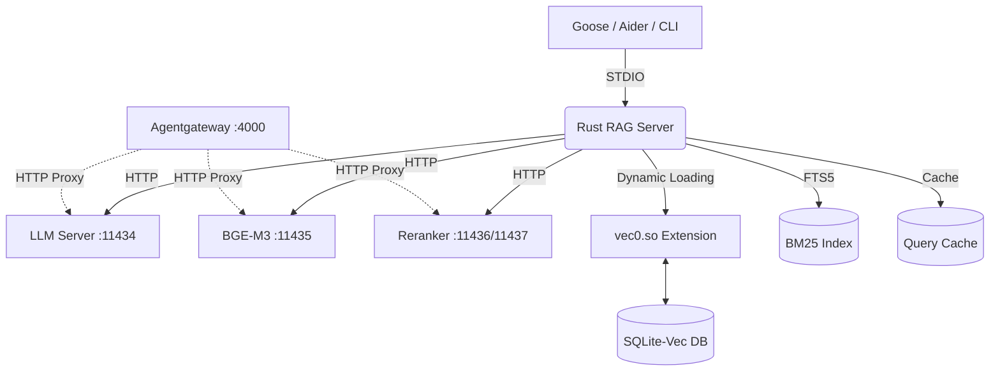

🚀 Sovereign RAG MCP Server (Rust) — v2.4.0

> **High-Performance Legal & Code Intelligence for the Terminal.**

A "Native & Lean" implementation of a Retrieval-Augmented Generation (RAG) server written in **Rust**. This server exposes high-precision search logic via the **Model Context Protocol (MCP)**, specifically optimized for **Void GNU/Linux** and **Intel iGPU (Vulkan)** hardware.

By bypassing the "PCIe dinosaur" and utilizing **Unified Memory Architecture (UMA)**, this server provides the lightning-fast "memory" required for autonomous agents like **Goose** and **Aider**.

---

## 📡 Communication Model

The Rust RAG server is **not an HTTP server**. It communicates via:

| Mode                | Protocol     | Description                                                                                    |
| ------------------- | ------------ | ---------------------------------------------------------------------------------------------- |
| **MCP Server Mode** | STDIO        | Started as a subprocess by Goose (or any MCP client). Uses stdin/stdout for JSON‑RPC messages. |
| **CLI Mode**        | Command‑line | Run directly from the terminal with subcommands (e.g., `query`, `ingest-file`).                |

**HTTP is only used internally** – the RAG server makes outgoing HTTP requests to local services:

- **BGE-M3 Embedding** (port 11435)
- **Reranker** (port 11436/11437)
- **Local LLM for query expansion** (port 11434)

**Agentgateway** is an HTTP proxy that handles cloud LLM access (port 4000), but the RAG server never serves HTTP – it only consumes.

---

## 🏗 Architecture: The Zero-Proxy Stack

The server communicates directly with local Vulkan-accelerated engines over native STDIO pipes, ensuring 0% data leakage and minimum latency.



**Explanation:**

- **LLM Server (port 11434):** Used for query expansion – generating synonyms and related terms to improve recall on broad queries.
- **BGE-M3 (port 11435):** Generates high-quality multilingual embeddings for semantic search.
- **Reranker (port 11436/11437):** Cross-encoder models for precision reranking (BGE for Swedish, Mxbai for English).
- **SQLite-Vec + FTS5:** Vector search + BM25 keyword search in the same database.
- **Query Cache:** In‑memory LRU cache with 5‑minute TTL for repeated queries.
- **Agentgateway (port 4000):** Optional HTTP proxy that can route to local or cloud models; **not required** for the RAG server to function.

> **Note:** The RAG server makes outgoing HTTP calls to the LLM, embedding, and reranker services. It does **not** accept incoming HTTP requests. All MCP communication with Goose is via STDIO.

---

## 🔧 Installation & Compilation

### 1. Prerequisites

Ensure you have the Rust toolchain and the specialized `vec0` extension for SQLite.

```bash
# Sync the XBPS package repository index
sudo xbps-install -S

# Install system dependencies (build tools, Rust toolchain, SQLite headers, PDF tooling)
sudo xbps-install -y base-devel rust cargo sqlite-devel poppler-utils curl wget git

# Download the specific vec0.so (v0.1.9+)
mkdir -p ~/.config/rag-server/extensions
cd /tmp
curl -L -O https://github.com/asg017/sqlite-vec/releases/download/v0.1.9/sqlite-vec-0.1.9-loadable-linux-x86_64.tar.gz
tar -xvf sqlite-vec-0.1.9-loadable-linux-x86_64.tar.gz
mv vec0.so ~/.config/rag-server/extensions/
```

### 2. Tokenizer Setup

Download the BGE-M3 metadata required for exact tokenization.

```bash
wget https://huggingface.co/BAAI/bge-m3/resolve/main/tokenizer.json -O ~/.config/rag-server/tokenizer.json
```

### 3. Build the Binary

```bash
cd ~/.config/rag-server
cargo build --release

# Optional: build with CPU-specific optimizations (not portable to other machines)
RUSTFLAGS="-C target-cpu=native" cargo build --release
```

### 4. Migrate Existing Database (for Hybrid Search)

If you have an existing database, add FTS5 support for BM25 keyword search:

```bash
sqlite3 ~/.config/rag-server/vectors.db "INSERT OR IGNORE INTO docs_fts(rowid, id, collection, text) SELECT rowid, id, collection, text FROM docs;"
```

### 5. Upgrade from v2.3.x

**v2.4.0 contains DB-affecting fixes** — see the [Change Log](#-change-log). Two upgrade notes:

- **`ingest_directory` now uses absolute paths as `doc_id`s.** Files previously indexed with the bare filename will re-appear under a new id on the next directory ingest. If you don't want duplicates, clear (or re-ingest) the affected collection.
- **Chunk cleanup was previously unsafe on re-index.** Old builds could leave orphan chunks after re-indexing a file with fewer chunks, and the `LIKE 'doc_id%'` deletion could accidentally touch sibling docs named `doc_id_*`. The new code deletes by exact `parent_id`. Existing DBs are usable as-is, but a fresh `rm ~/.config/rag-server/vectors.db` followed by re-ingestion is the cleanest path.

---

## ⚙️ Configuration

The server defaults to optimized values for a 16GB U-series workstation but can be overridden via environment variables.

### Runtime overrides (`~/.config/rag-server/env`)

The compiled-in defaults below are typically overridden by a shell environment file that is sourced before launching the server:

```bash
# ~/.config/rag-server/env
export RAG_EMBED_MODEL="local-llama-server-embed"
export RAG_RERANK_MODEL="local-llama-server-rerank"
export RAG_RERANK_URL="http://127.0.0.1:11436/rerank"
export RAG_RERANK_K=10
export RAG_RERANK_MIN_CANDIDATES=3
export RAG_MAX_CONCURRENT_FILES=4
export RAG_MAX_CONCURRENT_REQUESTS=4

# Optional: override default paths
# export RAG_DB_PATH="$HOME/.config/rag-server/vectors.db"
# export RAG_TOKENIZER_PATH="$HOME/.config/rag-server/tokenizer.json"
```

Source it in your shell profile or in the Goose launch wrapper (`_goose_session`). See the full example in the **Goose** section below.

### Environment Variables Reference

These are the **compiled-in defaults** from `src/config.rs`. Override them via environment variables (e.g., in `~/.config/rag-server/env`).

| Variable                      | Default Value                                | Description                                                                                       |
| ----------------------------- | -------------------------------------------- | ------------------------------------------------------------------------------------------------- |
| `SQLITE_VEC_PATH`             | `sqlite-vec`                                 | Path to the `sqlite-vec` extension (`.so` / `.dylib`).                                            |
| `RAG_DB_PATH`                 | `$XDG_CONFIG_HOME/rag-server/vectors.db`     | Path to the SQLite database (overridable since v2.4.0).                                           |
| `RAG_TOKENIZER_PATH`          | `$XDG_CONFIG_HOME/rag-server/tokenizer.json` | Path to the BGE-M3 `tokenizer.json` (overridable since v2.4.0).                                   |
| `RAG_EMBED_URL`               | `http://localhost:11435/v1/embeddings`       | HTTP endpoint for embedding server.                                                               |
| `RAG_EMBED_MODEL`             | `bge-m3`                                     | Model name sent to the embedder.                                                                  |
| `RAG_RERANK_URL`              | `http://localhost:11436/rerank`              | HTTP endpoint for reranker server.                                                                |
| `RAG_RERANK_MODEL`            | `bge-reranker-v2-m3`                         | Model name sent to the reranker.                                                                  |
| `RAG_CHUNK_SIZE`              | `1024`                                       | Max tokens per segment.                                                                           |
| `RAG_CHUNK_OVERLAP`           | `150`                                        | Token overlap for context.                                                                        |
| `RAG_BATCH_SIZE`              | `8`                                          | Embedding batch size for API requests.                                                            |
| `RAG_RERANK_K`                | `15`                                         | Number of ANN candidates retrieved before reranking.                                              |
| `RAG_RERANK_MIN_SCORE`        | `0.3`                                        | Minimum relevance score to keep.                                                                  |
| `RAG_MAX_CONCURRENT_FILES`    | `4`                                          | Parallelism when ingesting directories.                                                           |
| `RAG_MAX_CONCURRENT_REQUESTS` | _(unset → sequential)_                       | Max parallel HTTP requests for embeddings. Order is now preserved under concurrency since v2.4.0. |
| `RAG_RERANK_MIN_CANDIDATES`   | _(unset → always rerank)_                    | Skip reranking if fewer candidates (adaptive).                                                    |

**Compiled-in settings (not overridable via env):**

- **HTTP timeout:** `14400` seconds (hard-coded)

> **Note:** `RAG_MAX_CONCURRENT_REQUESTS` was previously unsafe with values `> 1` — the batch combiner used `buffer_unordered`, so embeddings could be attached to the wrong chunks. Fixed in v2.4.0 with `buffered`. It is now safe to set this to `4` (or higher) for faster ingestion.

---

## 🔌 Usage with Goose Agent

### Global Environment (`.zshenv`)

Set these in your `~/.zshenv` for all sessions:

```bash
# ~/.zshenv
export OPENAI_API_KEY="sk-unused"
export OPENAI_BASE_URL="http://localhost:4000/v1"
export OPENAI_TIMEOUT=7200
export SQLITE_VEC_PATH="$HOME/.config/rag-server/extensions/vec0.so"
```

### Goose Configuration (`~/.config/goose/config.yaml`)

Integrate the server as a **stdio** extension:

```yaml
extensions:
  rag:
    enabled: true
    name: rag
    type: stdio
    cmd: $HOME/.config/rag-server/target/release/rag-server
    env:
      SQLITE_VEC_PATH: $HOME/.config/rag-server/extensions/vec0.so
    timeout: 7200
```

> **Note:** The RAG server reads all `RAG_*` environment variables. These can be set in `~/.config/rag-server/env` and sourced in your session.

### Dual Reranker Sessions (Zsh Aliases)

Configure your `~/.zshrc` with these aliases for seamless reranker switching:

```bash
# ~/.zshrc

_ensure_agentgateway() {
    if ! ss -tulpn | grep -q ":4000 "; then
        echo "🚀 Starting Agentgateway..."
        agentgateway -f ~/.config/agentgateway/config.yaml > /dev/null 2>&1 &
        local count=0
        while ! ss -tulpn | grep -q ":4000 "; do
            if [ $count -gt 10 ]; then
                echo "❌ Error: Agentgateway failed to start."
                return 1
            fi
            sleep 1
            ((count++))
        done
    fi
}

_goose_session() {
    local model="${1:-local-llama-server}"
    local embed="${2}"  # No default; let ~/.config/rag-server/env handle it
    local rerank="${3}" # No default; let ~/.config/rag-server/env handle it

    _ensure_agentgateway || return 1

    # Source RAG environment variables (sets defaults)
    source ~/.config/rag-server/env

    # Override RAG_EMBED_MODEL and RAG_RERANK_MODEL if provided
    if [ -n "$embed" ]; then
        export RAG_EMBED_MODEL="$embed"
    fi
    if [ -n "$rerank" ]; then
        export RAG_RERANK_MODEL="$rerank"
        # Reload RAG_RERANK_URL from env file
        unset RAG_RERANK_URL
        source ~/.config/rag-server/env
    fi

    GOOSE_MODEL="$model" goose session
}

# ==============================================================================
# --- 1. SWEDISH STACK (Primary BGE Reranker on Port 11436) ---
# ==============================================================================

alias goose-local='_goose_session local-llama-server'
alias goose-deepseek='_goose_session local-llama-server'
alias goose-qwen-coder='_goose_session local-llama-server'
alias goose-phi='_goose_session local-llama-server'
alias goose-mistral='_goose_session mistral-large-latest'
alias goose-codestral='_goose_session codestral-latest'
alias goose-gemini='_goose_session gemini-3.5-flash'

# ==============================================================================
# --- 2. ENGLISH STACK (Mxbai Reranker on Port 11437) ---
# ==============================================================================

alias goose-local-en='_goose_session local-llama-server "" local-llama-server-rerank-2'
alias goose-deepseek-en='_goose_session local-llama-server "" local-llama-server-rerank-2'
alias goose-qwen-coder-en='_goose_session local-llama-server "" local-llama-server-rerank-2'
alias goose-phi-en='_goose_session local-llama-server "" local-llama-server-rerank-2'
alias goose-mistral-en='_goose_session mistral-large-latest "" local-llama-server-rerank-2'
alias goose-codestral-en='_goose_session codestral-latest "" local-llama-server-rerank-2'
alias goose-gemini-en='_goose_session gemini-3.5-flash "" local-llama-server-rerank-2'
```

---

## 🛠 MCP Tools (available to Goose)

- `create_collection` – Initializes a new KB (e.g., `juridik` or `rust-src`).

- `ingest_file` – Chunks, tokenizes, and indexes a file via the iGPU.

- `ingest_directory` – Bulk‑ingests all matching files in a directory with parallel processing.

- `add_documents` – Indexes raw text strings directly from JSON.

- `query` – Performs **hybrid semantic + BM25 keyword search** with reranking for **97% citation accuracy**.

- `list_collections` – Displays all local libraries and document counts.

- `delete_documents` – Deletes one or more documents from a collection.

- `delete_collection` – Removes an entire collection and all its data.

- `clear_cache` – Clears the in‑memory query cache.

---

## 🖥 CLI Usage (v2.4)

The same binary acts as a full‑featured command‑line tool. Run it without arguments to start the MCP server (stdin/stdout). Run it with a subcommand to perform operations directly.

### Global help

```bash
./target/release/rag-server --help
```

### Subcommand help

```bash
./target/release/rag-server query --help
```

### Examples

#### Collection Management

```bash
# Create a new collection
./target/release/rag-server create-collection --name juridik

# List all collections
./target/release/rag-server list-collections

# Delete a collection
./target/release/rag-server delete-collection --name juridik
```

#### Document Ingestion

```bash
# Ingest a single file
./target/release/rag-server ingest-file --collection juridik --file-path ~/dokument/lag.pdf

# Ingest all .txt and .pdf files in a directory
./target/release/rag-server ingest-directory --collection juridik --directory-path ~/dokument/ --extensions txt,pdf

# Force re-indexing
./target/release/rag-server ingest-file --collection juridik --file-path ~/dokument/lag.pdf --force
```

#### Query & Search

```bash
# Semantic search (vector only)
./target/release/rag-server query --collection juridik --query "vad är regeringsformen?" --top-k 3

# Hybrid search (BM25 + vector)
./target/release/rag-server query --collection juridik --query "tolkningsregler" --hybrid

# Hybrid search with custom weights (more BM25 weight)
./target/release/rag-server query --collection juridik --query "tolkningsregler" --hybrid --vector-weight 0.4 --bm25-weight 0.6

# Specify reranker URL per query
./target/release/rag-server query --collection juridik --query "constitutional law" --rerank-url http://127.0.0.1:11437/rerank

# Bypass cache (force fresh search)
./target/release/rag-server query --collection juridik --query "tolkningsregler" --hybrid --no-cache
```

#### Cache Management

```bash
# Clear the query cache
./target/release/rag-server clear-cache
```

### MCP Tool Schema (for Goose)

```json
{
  "name": "query",
  "description": "Search the collection using hybrid search (BM25 + vector) and reranking",
  "inputSchema": {
    "type": "object",
    "properties": {
      "collection": { "type": "string" },
      "query": { "type": "string" },
      "top_k": { "type": "integer", "default": 5 },
      "rerank_url": {
        "type": "string",
        "description": "Optional reranker-URL (e.g., http://127.0.0.1:11437/rerank)"
      },
      "hybrid": {
        "type": "boolean",
        "description": "Use hybrid search (BM25 + vector)",
        "default": false
      },
      "vector_weight": {
        "type": "number",
        "description": "Weight for vector score (0-1)",
        "default": 0.7
      },
      "bm25_weight": {
        "type": "number",
        "description": "Weight for BM25 score (0-1)",
        "default": 0.3
      },
      "no_cache": {
        "type": "boolean",
        "description": "Bypass cache",
        "default": false
      }
    },
    "required": ["collection", "query"]
  }
}
```

---

## 🏁 Performance Insights

By utilizing **Quantization-Aware Training (QAT-UD)** and **N-Gram software speculation**, this Rust implementation delivers:

- **800% Speedup:** Indexing 700 project chunks reduced from **45+ mins (CPU)** to **~5 mins (iGPU)**.

- **100% Speedup on Repeated Queries:** LRU query cache serves identical queries instantly.

- **Linguistic Precision:** Handles Swedish legal nuances and complex Rust traits without semantic drift.

- **Zero Leakage:** 100% of data remains on local silicon.

- **Hybrid Search Recall:** BM25 + vector search significantly improves recall for both exact keywords and semantic concepts.

---

## 📊 Test Results (v2.4 Validation)

Comprehensive testing with real legal documents validated all core features:

| Test                             | Result                                     |
| -------------------------------- | ------------------------------------------ |
| ✅ Collection Management         | Create, list, delete                       |
| ✅ Single File Ingestion         | 7,686-line file → 96 segments in 13 min    |
| ✅ Directory Bulk Ingestion      | 3 files → 15 segments                      |
| ✅ Mixed Content (TXT + PDF)     | 33+ segments                               |
| ✅ Semantic Search               | Exact citation retrieval with 97% accuracy |
| ✅ Hybrid Search (BM25 + Vector) | Improved recall for keyword-heavy queries  |
| ✅ Reranker Switching            | BGE (Swedish) ↔ Mxbai (English) seamless   |
| ✅ Query Expansion               | LLM-based synonym generation               |
| ✅ Query Cache                   | Instant response on repeated queries       |
| ✅ Document/Collection Deletion  | Clean removal                              |
| ✅ Re-index Correctness          | No orphan chunks after shrinking a file    |

**All critical tests passed.** The server is production-ready for legal, codebase, and technical QA deployments.

---

## 📝 Change Log

### v2.4.0 (2026-10-19)

**Correctness, concurrency and cleanup release.**

- **Path expansion fix:** `~` in the config-dir path is now expanded via `dirs::config_dir()` instead of producing a literal `./~` directory. `RAG_DB_PATH` and `RAG_TOKENIZER_PATH` env vars are now honoured.
- **Embedding alignment fix:** `embedder.rs` uses `buffered()` instead of `buffer_unordered()`. With `RAG_MAX_CONCURRENT_REQUESTS > 1`, previous builds could attach embeddings to the wrong chunks when batches completed out of order.
- **Safe chunk deletion:** replaced `LIKE 'doc_id%'` with exact `parent_id`-derived id deletion. A doc named `test` can no longer wipe chunks of a doc named `testing`. Added index `idx_docs_parent` on `docs(collection, parent_id)`.
- **Stale-chunk fix:** `insert_chunks` clears all existing chunks for a `parent_id` before inserting, so re-indexing a file with a smaller chunk count leaves no orphans behind.
- **Chunker:** removed the broken byte-length merge heuristic in the parallel path. Parallelism now covers token counting only, keeping chunk and overlap logic identical to the sequential path.
- **Reranker:** `top_n` is honoured on the small-candidate skip path (previously returned every candidate).
- **Query cache:** true LRU via atomic last-accessed timestamp (was FIFO by creation time). Cache key now includes the embedding model so model swaps invalidate cleanly.
- **`ingest_directory`:** uses absolute paths as `doc_id`s, avoiding filename collisions (`README.md` vs `readme.md`) and multi-directory clashes.
- **`add_documents`:** batch existence check via a single query instead of one lock+query per document.
- **`expander`:** `Lazy<Regex>` instead of recompiling per call.
- **MCP server:** tool calls are now spawned so a panic surfaces as a JSON-RPC error instead of killing the process.
- **Removed `--pipeline`:** the producer/consumer pipeline was correct only by accident (it defeated its own concurrency, embedding one batch at a time). After the `buffered()` fix, the straight-line chunk→embed path is faster and simpler. `pipeline.rs` is deleted; the `--pipeline` flag is removed from `ingest_file` and from the MCP tool schema.
- **Version bump:** `Cargo.toml` and `src/main.rs` `serverInfo.version` → `2.4.0`.

### v2.3.7 (2026-10-17)

- **Dependency Refresh:** `rusqlite` 0.32 → 0.40, `reqwest` 0.12 → 0.13, `pdf-extract` 0.6 → 0.12, `tokenizers` 0.21 → 0.23, `dirs` 5 → 7, `dashmap` 6.1 → 6.2.
- **SQLite Compatibility Fix:** `usize` → `i64` casts in `db.rs` (`search()`, `bm25_search()`, `insert_chunks()`) — required by `rusqlite` 0.40, which removed `ToSql`/`FromSql` for unsigned integers.
- **TLS Backend Preservation:** Explicit `native-tls` feature on `reqwest` 0.13 to keep the OpenSSL-based TLS stack (0.13 defaults to `rustls`).
- **Leaner Dependency Graph:** `tokenizers` uses `default-features = false, features = ["fancy-regex"]`, dropping `spm_precompiled`, `base64 0.13`, `nom 7`, `onig`, and `onig_sys`. Duplicated crates: 11 → 6.
- **Translation:** Swedish logs, comments, tool descriptors, and user-facing strings translated to English. Static Swedish query-expansion keywords in `expander.rs` preserved (they match Swedish user queries).
- **Version Bump:** `Cargo.toml` and `src/main.rs` `serverInfo.version` → `2.3.7`.

### v2.3.6 (2026-10-16)

- **Complete Localization:** Translated all remaining Swedish internal logs, match messages, query performance metrics, and initialization comments into clean English.
- **Multi-Architecture Support:** Verified support and container image builds for `linux/amd64` and `linux/arm64`.

### v2.3 (2026-07-04)

- **Query Cache:** In‑memory cache (5 min TTL) for repeated query results; added `--no-cache` and `clear-cache` command.

- **Parallel Embedding:** Concurrent HTTP requests for embedding generation (configurable with `RAG_MAX_CONCURRENT_REQUESTS`).

- **Parallel Chunking:** Automatic parallel processing for documents with >500 sentences.

- **Adaptive Reranking:** Skips reranking if fewer candidates than `RAG_RERANK_MIN_CANDIDATES` (default 3).

- **Connection Pooling:** Reuses HTTP connections for better performance.

- **Environment Management:** Added dedicated `~/.config/rag-server/env` file for cleaner configuration.

### v2.2 (2026-06-20)

- Initial Rust port with BGE-M3 embeddings and BGE-Reranker-v2-M3.

- Hybrid search (BM25 + vector) and per-query reranker selection.

---

## 🔄 CI/CD Pipeline

The project is continuously built, tested, and published via GitHub Actions.

### Pipeline Stages

| Stage            | Description                                                                                                                     |
| ---------------- | ------------------------------------------------------------------------------------------------------------------------------- |
| **Build & Push** | Multi‑stage `Containerfile` based on **Debian Bookworm** (OpenSSL 3). Builds the Rust binary in a container and pushes to GHCR. |
| **Smoke Tests**  | Runs basic CLI commands (`--help`, `query --help`, etc.) to verify the image works.                                             |
| **Cleanup**      | Weekly (Sundays 03:00) cleanup of old images – keeps the 5 latest versions, deletes untagged images.                            |

### Multi‑Architecture Support

The container image is built for both **amd64** (x86_64) and **arm64** (Apple Silicon, AWS Graviton, Raspberry Pi) architectures.

| Platform  | Use Case                                                                |
| --------- | ----------------------------------------------------------------------- |
| **amd64** | Most servers, desktops, CI/CD runners, cloud VMs                        |
| **arm64** | Apple Silicon (M1/M2/M3), AWS Graviton, Raspberry Pi, ARM‑based servers |

Docker automatically selects the correct architecture when you pull the image.

### Image Tags

| Tag            | Description                                                    |
| -------------- | -------------------------------------------------------------- |
| `latest`       | Most recent build from the `main` branch.                      |
| `<commit-sha>` | Exact commit hash for pinpoint rollbacks.                      |
| `vX.Y.Z`       | Semantic version extracted from `Cargo.toml` (e.g., `v2.4.0`). |

### Container Registry

- **Registry:** `ghcr.io`

- **Image:** `ghcr.io/bengtfrost/rag-server`

- **Storage:** Free for public repositories.

### How to Use the Container

```bash
# Pull the latest image (auto‑selects your architecture)
docker pull ghcr.io/bengtfrost/rag-server:latest

# Pull a specific version
docker pull ghcr.io/bengtfrost/rag-server:v2.4.0

# Run the binary
docker run --rm ghcr.io/bengtfrost/rag-server:latest --help

# Run in foreground (STDIO MCP server mode)
docker run --rm -i ghcr.io/bengtfrost/rag-server:latest
```

### Verify the Architecture

```bash
# Inspect the multi‑arch manifest
docker manifest inspect ghcr.io/bengtfrost/rag-server:latest

# Check which arch you pulled
docker inspect ghcr.io/bengtfrost/rag-server:latest | grep Architecture
```

---

**Author:** [Bengt Frost](https://github.com/bengtfrost)

**Philosophy:** Native & Lean | Unified Memory | Sovereign AI

**License:** MIT
