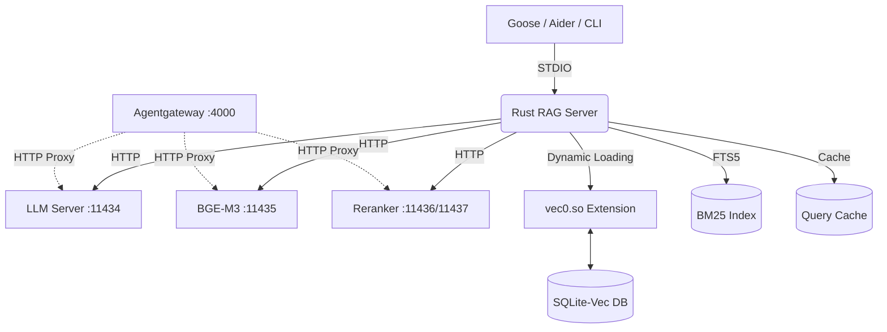

🚀 Sovereign RAG MCP Server (Rust) — v2.4.4

[](https://github.com/bengtfrost/rag-server/actions/workflows/ci-cd.yml)
[](https://github.com/bengtfrost/rag-server/pkgs/container/rag-server)
[](https://github.com/bengtfrost/rag-server/pkgs/container/rag-server)
[](https://github.com/bengtfrost/rag-server/tags)

> **High-Performance Legal & Code Intelligence for the Terminal.**

A "Native & Lean" implementation of a Retrieval-Augmented Generation (RAG) server written in **Rust**. This server exposes high-precision search logic via the **Model Context Protocol (MCP)**, specifically optimized for **Void GNU/Linux** and **Intel iGPU (Vulkan)** hardware.

By bypassing the "PCIe dinosaur" and utilizing **Unified Memory Architecture (UMA)**, this server provides the lightning-fast "memory" required for autonomous agents like **Goose** and **Aider**.

> **Latest release: v2.4.4 — container build fix.** **Do not pull
> `ghcr.io/bengtfrost/rag-server:v2.4.3`** — that image was built from a
> broken container cache and ships a dummy `fn main() {}` binary (silent
> CLI, no output). Source builds from the `v2.4.3` tag are unaffected. See
> [Changelog → v2.4.4](#v244-2026-11-15) and
> [Troubleshooting → "The binary runs but does nothing"](#the-binary-runs-but-does-nothing-empty-output-exit-0).

> **Binary name.** The Cargo package and binary are `rag-server-mcp` (see `Cargo.toml`). Earlier revisions of this README used `rag-server` in examples; if your Goose config or shell aliases still point at `rag-server`, either update them or add a symlink:
>
> ```bash
> ln -s ~/.config/rag-server/target/release/rag-server-mcp \
>       ~/.config/rag-server/target/release/rag-server
> ```
>
> Every command below uses `rag-server-mcp` for consistency.

---

## 📡 Communication Model

The Rust RAG server is **not an HTTP server**. It communicates via:

| Mode                | Protocol     | Description                                                                                        |
| ------------------- | ------------ | -------------------------------------------------------------------------------------------------- |
| **MCP Server Mode** | STDIO        | Started as a subprocess by Goose (or any MCP client). Uses stdin/stdout for JSON-RPC 2.0 messages. |
| **CLI Mode**        | Command-line | Run directly from the terminal with subcommands (e.g. `query`, `ingest-file`).                     |

**HTTP is only used outbound** — the RAG server makes HTTP requests to local services:

- **BGE-M3 embedding** (default port 11435)
- **Reranker** (default port 11436 / 11437)
- **Local LLM for query expansion** (default port 4000 via Agentgateway, or direct at 11434)

**Agentgateway** is an HTTP proxy that handles cloud LLM access. The RAG server never serves HTTP — it only consumes.

---

## 🏗 Architecture: The Zero-Proxy Stack

The server communicates directly with local Vulkan-accelerated engines over native STDIO pipes, ensuring 0% data leakage and minimum latency.



**Explanation:**

- **LLM Server (port 11434 / 4000):** Used for query expansion — generating synonyms and related terms to improve recall on broad queries.
- **BGE-M3 (port 11435):** Generates high-quality multilingual embeddings for semantic search.
- **Reranker (port 11436 / 11437):** Cross-encoder models for precision reranking (BGE for Swedish, Mxbai for English).
- **SQLite-Vec + FTS5:** Vector search + BM25 keyword search in the same database.
- **Query Cache:** In-memory LRU cache with 5-minute TTL, race-safe eviction, and hit/miss/eviction counters logged at shutdown.
- **Agentgateway (port 4000):** Optional HTTP proxy that can route to local or cloud models; **not required** for the RAG server to function.

> **Note:** The RAG server makes outgoing HTTP calls to the LLM, embedding, and reranker services. It does **not** accept incoming HTTP requests. All MCP communication with Goose is via STDIO.

---

## 🔧 Installation & Compilation

### 1. Prerequisites

Ensure you have the Rust toolchain and the specialized `vec0` extension for SQLite.

```bash
# Sync the XBPS package repository index
sudo xbps-install -S

# Install system dependencies (build tools, Rust toolchain, SQLite headers, PDF tooling)
sudo xbps-install -y base-devel rust cargo sqlite-devel poppler-utils curl wget git

# Download the specific vec0.so (v0.1.9+)
# Since v2.4.2 the recommended home is resources/extensions/ — the binary
# probes <resources>/extensions/vec0.{so,dylib,dll} first, where <resources>
# is auto-resolved as $RAG_RESOURCES_DIR → <exe_dir>/resources →
# <crate_root>/resources.
mkdir -p ./resources/extensions
cd /tmp
curl -L -O https://github.com/asg017/sqlite-vec/releases/download/v0.1.9/sqlite-vec-0.1.9-loadable-linux-x86_64.tar.gz
tar -xvf sqlite-vec-0.1.9-loadable-linux-x86_64.tar.gz
mv vec0.so ~/.config/rag-server/resources/extensions/   # canonical location

# Legacy layout still works (probed after resources/):
#   mkdir -p ./extensions && mv vec0.so ./extensions/vec0.so
# Or skip copying altogether and use the explicit override:
#   export RAG_VEC0_EXTENSION_PATH=/usr/local/lib/vec0.so
```

If you prefer a system-wide install, `mv vec0.so` to a directory the dynamic loader searches (`/usr/local/lib`, etc.) — the resolver falls back to a bare `"vec0"` sentinel that lets the system loader find it. See [Configuration → Path resolution](#path-resolution).

> **`vec0.so` is gitignored.** A fresh `git clone` does **not** include it — the source tarball on GitHub does not include it either. Download it once as above, or set `RAG_VEC0_EXTENSION_PATH` to wherever you keep it. Since v2.4.3 the server refuses to start with a clear error if it can't find the extension.

### 2. Tokenizer Setup

The BGE-M3 tokenizer is **tracked in the repo** at `resources/tokenizer.json` (since v2.4.2). A fresh `git clone` already includes it — no download step needed for source checkouts.

If you need to fetch it manually (e.g. because you deleted the file, or you're installing from a source tarball that strips it):

```bash
# Recommended location — matches the binary's default probe:
wget https://huggingface.co/BAAI/bge-m3/resolve/main/tokenizer.json \
     -O resources/tokenizer.json

# Legacy override if you prefer a stable path:
wget https://huggingface.co/BAAI/bge-m3/resolve/main/tokenizer.json \
     -O ~/.config/rag-server/resources/tokenizer.json
```

### 3. Build the Binary

```bash
cd ~/.config/rag-server
cargo build --release

# Optional: build with CPU-specific optimizations (not portable to other machines)
RUSTFLAGS="-C target-cpu=native" cargo build --release
```

> **Since v2.4.1 the release profile uses lto = "thin", codegen-units = 1, and strip = "symbols". First builds take noticeably longer (~5–10 min on a typical U-series laptop) but the binary is smaller and faster at runtime. Debug builds and incremental builds are unaffected.

The resulting binary is `./target/release/rag-server-mcp`.

### 4. Migrate an Existing Database (for Hybrid Search)

If you have a database from before v2.3, populate the FTS5 mirror of `docs` so BM25 keyword search works:

```bash
sqlite3 ~/.config/rag-server/vectors.db \
  "INSERT OR IGNORE INTO docs_fts(rowid, id, collection, text)
   SELECT rowid, id, collection, text FROM docs;"
```

### 5. Upgrade Notes (v2.4.2 → v2.4.4)

Two releases, both behaviour-compatible with v2.4.2. Existing databases open unchanged; existing env files keep working.

- **v2.4.3 — fail-fast on missing `vec0`.** (Below.)
- **v2.4.4 — container build fix.** The `v2.4.3` container image shipped a dummy `fn main() {}` binary (silent CLI, exit 0 with no output). If you pulled that image, delete it locally and re-pull `v2.4.4`:

  ```bash
  docker rmi ghcr.io/bengtfrost/rag-server:v2.4.3 ghcr.io/bengtfrost/rag-server:latest 2>/dev/null
  docker pull ghcr.io/bengtfrost/rag-server:v2.4.4
  ```

  Source builds from the `v2.4.3` tag are unaffected — the Rust crate itself compiles normally. The bug was in the Docker build path only (Containerfile cache-trick + mtime interaction).

The v2.4.3 changes, documented in full below (they were missing from the v2.4.2 tag's README, hence their prominence here):

- **Startup fails fast on a missing `vec0`.** If the extension can't be located — via `RAG_VEC0_EXTENSION_PATH`, `SQLITE_VEC_PATH` (legacy alias), or the auto-resolved `resources/extensions/vec0.{so,dylib,dll}` — `rag-server-mcp` now refuses to start with one actionable error. Previously it emitted a `WARN` and then died inside `Db::new()` with SQLite's cryptic `…/vec0.so.so: cannot open shared object file`. That was the exact symptom of a stale env var pointing at a moved file. Now the error names the resolved path and the three remedies.
- **v2.4.2 docs finally land.** The v2.4.2 tag shipped with the v2.4.1 README — the resource layout rewrite (`resources/tokenizer.json`, `resources/extensions/`), the `RAG_RESOURCES_DIR` and `RAG_VEC0_EXTENSION_PATH` env vars, the three-tier resolution, and the full v2.4.2 changelog entry were all missing from the tag. The v2.4.3 README included them.

The v2.4.2 changes, documented in full below (they were missing from the v2.4.2 tag's README, hence their prominence here):

- **Resource layout moved to `resources/`.** `tokenizer.json` now lives at `resources/tokenizer.json` and is tracked in git. The SQLite extension is re-homed to `resources/extensions/vec0.{so,dylib,dll}` and remains **gitignored**.
- **Three-tier resource resolution.** `$RAG_RESOURCES_DIR` → `<exe_dir>/resources` → `<CARGO_MANIFEST_DIR>/resources`. Same binary works from `cargo run`, an installed location, and the container image without recompilation.
- **New env vars.** `RAG_RESOURCES_DIR` (root override) and `RAG_VEC0_EXTENSION_PATH` (canonical name, platform-aware `.so` / `.dylib` / `.dll`). `SQLITE_VEC_PATH` remains as a legacy alias.
- **Query cache hardening.** Race-safe eviction via `DashMap::remove_if`, insert-then-trim to avoid cap overshoot under concurrency, expired-first LRU sweep, hit/miss/eviction counters exposed via `stats()` and logged at shutdown.
- **Auto-tracking version.** `serverInfo.version` in MCP `initialize` and the CLI's `--version` both read `env!("CARGO_PKG_VERSION")`. No more hardcoded strings drifting from `Cargo.toml`.
- **`.gitignore` corrections.** The bare `env` file (no dot) is now correctly ignored. `vectors.db-*`, `perf.data*`, `*.profraw`, `.mcp.json`, `.direnv/` covered.
- **`env.example` template.** A tracked template at the repo root replaces the "env file is in the repo" arrangement. The real `env` lives at `~/.config/rag-server/env` (untracked), `chmod 600`.
- **Clippy clean.** `cargo clippy --all-targets -- -W clippy::pedantic` runs with **zero warnings** on `rustc 1.100.0`.

### 6. Upgrade Notes (v2.3.x → v2.4.1)

Three items worth acting on if you're upgrading from before v2.4.1:

- **`hybrid_search` had a silent correctness bug until v2.4.1.** It returned the _worst_ `k` candidates. If `--hybrid` gave worse results than plain vector search, this was why. Re-run any important hybrid queries after upgrading.
- **`ingest_directory` uses absolute paths as `doc_id`s since v2.4.0.** Files previously indexed by bare filename will re-appear under a new id on the next directory ingest. If you don't want duplicates, clear (or re-ingest) the affected collection.
- **Fresh-start recommendation.** v2.4.0 changed the chunk-deletion strategy from `LIKE 'doc_id%'` to exact `parent_id` matching, and added stale-chunk cleanup on re-index. Existing DBs work fine, but `rm ~/.config/rag-server/vectors.db` followed by a re-ingest is the cleanest path if you're not sure what's in there.

---

## ⚙️ Configuration

The server defaults to optimized values for a 16 GB U-series workstation, overridable via environment variables. A **tracked `env.example`** is provided at the repo root as a template — copy it to `~/.config/rag-server/env`, fill in only the values you need to override, `chmod 600`, and `source` it before launching the server.

### Runtime overrides (`~/.config/rag-server/env`)

The compiled-in defaults are usually sufficient. Only override what you must:

```bash
# ~/.config/rag-server/env — only set what you actually need to override.
# The template env.example at the repo root lists everything with defaults.

export RAG_EMBED_MODEL="local-llama-server-embed"
export RAG_RERANK_MODEL="local-llama-server-rerank"
export RAG_RERANK_URL="http://127.0.0.1:11436/rerank"
export RAG_RERANK_K=10
export RAG_RERANK_MIN_CANDIDATES=3
export RAG_MAX_CONCURRENT_FILES=4
export RAG_MAX_CONCURRENT_REQUESTS=4

# Observability. Logs go to stderr; stdout is the JSON-RPC wire.
# export RUST_LOG="rag_server_mcp=debug,info"

# Resource paths are auto-resolved since v2.4.2 — no env vars needed for a
# standard source checkout at $CARGO_MANIFEST_DIR. Only override for custom
# layouts (containers, packaged installs):
# export RAG_RESOURCES_DIR="$HOME/.config/rag-server/resources"
# export RAG_TOKENIZER_PATH="$RAG_RESOURCES_DIR/tokenizer.json"
# export RAG_VEC0_EXTENSION_PATH="$RAG_RESOURCES_DIR/extensions/vec0.so"
```

Source it in your shell profile or in the Goose launch wrapper (`_goose_session`). See the **Goose** section below.

> **Note on legacy names.** `SQLITE_VEC_PATH` is still honoured as an alias for `RAG_VEC0_EXTENSION_PATH` (checked second), so pre-v2.4.2 env files continue to work unchanged. Since v2.4.2 the `resources/` layout means **most users do not need to set either** — the binary resolves `<crate_root>/resources/extensions/vec0.{so,dylib,dll}` automatically.

### `env.example` (tracked template)

A tracked `env.example` at the repo root documents every variable the server understands, with defaults commented out. Copy it rather than starting from a blank file:

```bash
cp env.example ~/.config/rag-server/env
chmod 600 ~/.config/rag-server/env
$EDITOR ~/.config/rag-server/env
```

The repo's `env.example` is deliberately not pre-populated with any local paths — that's what makes it safe to commit and share. The real `env` lives at `~/.config/rag-server/env` and is gitignored.

### Environment Variables Reference

| Variable                      | Default Value                                                                                           | Description                                                                                                                 |
| ----------------------------- | ------------------------------------------------------------------------------------------------------- | --------------------------------------------------------------------------------------------------------------------------- |
| `RAG_RESOURCES_DIR`           | `$RAG_RESOURCES_DIR` → `<exe_dir>/resources` → `<crate_root>/resources`                                 | Root of the bundled resources (`tokenizer.json`, `extensions/`). **New in v2.4.2.**                                         |
| `RAG_VEC0_EXTENSION_PATH`     | `$RAG_RESOURCES_DIR/extensions/vec0.{so,dylib,dll}` → `./extensions/vec0.*` → `vec0` (system loader)    | Path to the `sqlite-vec` extension. **New in v2.4.2** — canonical name; platform-aware suffix.                              |
| `SQLITE_VEC_PATH`             | _(legacy alias for `RAG_VEC0_EXTENSION_PATH`)_                                                          | Still honoured, checked second after `RAG_VEC0_EXTENSION_PATH`. Kept for backward compatibility.                            |
| `RAG_TOKENIZER_PATH`          | `$RAG_RESOURCES_DIR/tokenizer.json` → `./tokenizer.json` → `$XDG_CONFIG_HOME/rag-server/tokenizer.json` | Path to the BGE-M3 `tokenizer.json`. Since v2.4.2 the `resources/` copy is tracked in git, so a fresh clone needs no setup. |
| `RAG_DB_PATH`                 | `$XDG_CONFIG_HOME/rag-server/vectors.db`                                                                | Path to the SQLite database (overridable since v2.4.0).                                                                     |
| `RAG_EMBED_URL`               | `http://localhost:11435/v1/embeddings`                                                                  | HTTP endpoint for embedding server.                                                                                         |
| `RAG_EMBED_MODEL`             | `bge-m3`                                                                                                | Model name sent to the embedder.                                                                                            |
| `RAG_RERANK_URL`              | `http://localhost:11436/rerank`                                                                         | HTTP endpoint for reranker server.                                                                                          |
| `RAG_RERANK_MODEL`            | `bge-reranker-v2-m3`                                                                                    | Model name sent to the reranker.                                                                                            |
| `RAG_EXPAND_URL`              | `http://localhost:4000/v1/chat/completions`                                                             | OpenAI-compatible endpoint for query expansion (Agentgateway by default). **New in v2.4.1.**                                |
| `RAG_EXPAND_AUTH_TOKEN`       | _(unset → no `Authorization` header)_                                                                   | Bearer token for the expander endpoint. If unset, no auth header is sent. **New in v2.4.1.**                                |
| `RAG_TIMEOUT_SECS`            | `14400`                                                                                                 | HTTP request timeout for embed / rerank / expand calls. **New in v2.4.1** (was hardcoded).                                  |
| `RAG_CHUNK_SIZE`              | `1024`                                                                                                  | Max tokens per segment. Must be > 0.                                                                                        |
| `RAG_CHUNK_OVERLAP`           | `150`                                                                                                   | Token overlap for context. Warned if >= `RAG_CHUNK_SIZE`.                                                                   |
| `RAG_BATCH_SIZE`              | `8`                                                                                                     | Embedding batch size for API requests. Must be > 0.                                                                         |
| `RAG_RERANK_K`                | `15`                                                                                                    | Number of ANN candidates retrieved before reranking.                                                                        |
| `RAG_RERANK_MIN_SCORE`        | `0.3`                                                                                                   | Minimum relevance score to keep.                                                                                            |
| `RAG_MAX_CONCURRENT_FILES`    | `4`                                                                                                     | Parallelism when ingesting directories.                                                                                     |
| `RAG_MAX_CONCURRENT_REQUESTS` | _(unset → sequential)_                                                                                  | Max parallel HTTP requests for embeddings. Order is preserved under concurrency since v2.4.0.                               |
| `RAG_RERANK_MIN_CANDIDATES`   | _(unset → always rerank)_                                                                               | Skip reranking if fewer candidates (adaptive).                                                                              |
| `RUST_LOG`                    | `rag_server_mcp=debug,info`                                                                             | `tracing` filter. Set to `info`, `debug`, `trace`, or a per-target filter. **New in v2.4.1.**                               |

> **Note:** `RAG_MAX_CONCURRENT_REQUESTS > 1` was unsafe before v2.4.0 (used `buffer_unordered`, embeddings could attach to the wrong chunks). Fixed with `buffered` — safe to raise to `4` or higher for faster ingestion.

### Path resolution

**For a standard source checkout, you don't need to set anything.** Since v2.4.2 the binary finds `resources/tokenizer.json` and `resources/extensions/vec0.{so,dylib,dll}` by walking three well-known locations, all relative to where the binary actually lives — no CWD dependence, no env vars required. This is the change that closed the "works when I `cd` to the repo root first" bug from earlier releases.

The full priority order is documented below for custom-layout cases (containers, packaged installs, third-party bundles).

**Step 1 — locate `<resources>`:**

1. `$RAG_RESOURCES_DIR` (explicit override).
2. `<dir of current_exe>/resources` (installed binary, container).
3. `<crate root>/resources` (dev build — `cargo run` or `cargo build` from a checkout).

**Step 2 — locate each file inside `<resources>`:**

**vec0.so** (`resolve_vec0_extension_path`):

1. `$RAG_VEC0_EXTENSION_PATH` (new canonical).
2. `$SQLITE_VEC_PATH` (legacy alias).
3. `<resources>/extensions/vec0.{so,dylib,dll}` — platform-aware extension.
4. `./extensions/vec0.{so,dylib,dll}` — legacy CWD probe, retained for back-compat.
5. Bare `"vec0"` — hands the load to the system dynamic loader (works when `sqlite-vec` is installed system-wide).

**tokenizer.json** (`resolve_tokenizer_path`):

1. `$RAG_TOKENIZER_PATH` (explicit override).
2. `<resources>/tokenizer.json` — tracked in git since v2.4.2; a fresh clone works with zero configuration.
3. `./tokenizer.json` — legacy CWD probe.
4. `$XDG_CONFIG_HOME/rag-server/tokenizer.json` — legacy install fallback.

The resolved paths are logged at startup under `RUST_LOG=info` (`resolved resource paths: tokenizer_path=… vec0_extension_path=…`) so you can confirm exactly which file was loaded.

Since v2.4.3 the server **refuses to start** if `vec0` can't be found, with a message naming the path it settled on. That's a deliberate change from the previous `WARN` + late failure inside `Db::new()`.

The `Containerfile` wires this together by placing both assets at `/usr/local/share/rag-server/resources/` and setting `RAG_RESOURCES_DIR` to that directory — same code path as an installed binary, so no special casing.

---

## 🔌 Usage with Goose Agent

### Global Environment (`.zshenv`)

Only `OPENAI_*` needs to be set — resource paths auto-resolve since v2.4.2.

```bash
# ~/.zshenv
export OPENAI_API_KEY="sk-unused"
export OPENAI_BASE_URL="http://localhost:4000/v1"
export OPENAI_TIMEOUT=7200

# No vec0/tokenizer env var needed for a source checkout at
# ~/.config/rag-server/. The binary resolves resources/ from the crate root.
#
# If you *want* to pin explicitly (e.g. for a custom install), use the
# canonical name — not the legacy SQLITE_VEC_PATH:
#   export RAG_VEC0_EXTENSION_PATH="$HOME/.config/rag-server/resources/extensions/vec0.so"
#
# For a container or a non-standard layout, the whole resources/ tree can
# be relocated with one variable:
#   export RAG_RESOURCES_DIR="/usr/local/share/rag-server/resources"
```

### Goose Configuration (`~/.config/goose/config.yaml`)

Integrate the server as a **stdio** extension. Since v2.4.2 you can omit the `env:` block entirely — the child process resolves `resources/` from the crate root the same way the CLI does:

```yaml
extensions:
  rag:
    enabled: true
    name: rag
    type: stdio
    cmd: $HOME/.config/rag-server/target/release/rag-server-mcp
    timeout: 7200
```

If you run the binary from a location where `<exe_dir>/resources` and `<$CARGO_MANIFEST_DIR>/resources` both miss (container image at `/usr/local/bin`, packaged install, etc.), point Goose at the resources dir explicitly:

```yaml
extensions:
  rag:
    enabled: true
    name: rag
    type: stdio
    cmd: $HOME/.config/rag-server/target/release/rag-server-mcp
    env:
      RAG_RESOURCES_DIR: /usr/local/share/rag-server/resources
    timeout: 7200
```

`RAG_VEC0_EXTENSION_PATH` and `RAG_TOKENIZER_PATH` remain available for finer per-file overrides. The legacy `SQLITE_VEC_PATH` is still accepted, but new configs should use `RAG_RESOURCES_DIR` (one variable for the whole tree) instead of pinning individual files.

> The RAG server reads all `RAG_*` environment variables. These can be set in `~/.config/rag-server/env` and sourced in your session — but the same "only override what you must" rule applies.

### Dual Reranker Sessions (Zsh aliases)

```bash
# ~/.zshrc

_ensure_agentgateway() {
    if ! ss -tulpn | grep -q ":4000 "; then
        echo "🚀 Starting Agentgateway..."
        agentgateway -f ~/.config/agentgateway/config.yaml > /dev/null 2>&1 &
        local count=0
        while ! ss -tulpn | grep -q ":4000 "; do
            if [ $count -gt 10 ]; then
                echo "❌ Error: Agentgateway failed to start."
                return 1
            fi
            sleep 1
            ((count++))
        done
    fi
}

_goose_session() {
    local model="${1:-local-llama-server}"
    local embed="${2}"   # empty = keep the ~/.config/rag-server/env value
    local rerank="${3}"  # empty = keep the ~/.config/rag-server/env value

    _ensure_agentgateway || return 1

    source ~/.config/rag-server/env

    if [ -n "$embed" ]; then
        export RAG_EMBED_MODEL="$embed"
    fi
    if [ -n "$rerank" ]; then
        export RAG_RERANK_MODEL="$rerank"
        unset RAG_RERANK_URL
        source ~/.config/rag-server/env
    fi

    GOOSE_MODEL="$model" goose session
}

# ==============================================================================
# --- 1. SWEDISH STACK (BGE reranker on port 11436) ---
# ==============================================================================
alias goose-local='_goose_session local-llama-server'
alias goose-deepseek='_goose_session local-llama-server'
alias goose-qwen-coder='_goose_session local-llama-server'
alias goose-phi='_goose_session local-llama-server'
alias goose-mistral='_goose_session mistral-large-latest'
alias goose-codestral='_goose_session codestral-latest'
alias goose-gemini='_goose_session gemini-3.5-flash'

# ==============================================================================
# --- 2. ENGLISH STACK (Mxbai reranker on port 11437) ---
# ==============================================================================
alias goose-local-en='_goose_session local-llama-server "" local-llama-server-rerank-2'
alias goose-deepseek-en='_goose_session local-llama-server "" local-llama-server-rerank-2'
alias goose-qwen-coder-en='_goose_session local-llama-server "" local-llama-server-rerank-2'
alias goose-phi-en='_goose_session local-llama-server "" local-llama-server-rerank-2'
alias goose-mistral-en='_goose_session mistral-large-latest "" local-llama-server-rerank-2'
alias goose-codestral-en='_goose_session codestral-latest "" local-llama-server-rerank-2'
alias goose-gemini-en='_goose_session gemini-3.5-flash "" local-llama-server-rerank-2'
```

---

## 🛠 MCP Tools (available to Goose)

- `create_collection` — Initializes a new knowledge base (e.g. `juridik` or `rust-src`).
- `ingest_file` — Chunks, tokenizes, and indexes a file via the iGPU.
- `ingest_directory` — Bulk-ingests all matching files in a directory with parallel processing.
- `add_documents` — Indexes raw text strings directly from JSON.
- `query` — Hybrid semantic + BM25 keyword search with reranking (97 % citation accuracy on the legal corpus).
- `list_collections` — Displays all local libraries and document counts.
- `delete_documents` — Deletes one or more documents from a collection.
- `delete_collection` — Removes an entire collection and all its data.
- `clear_cache` — Clears the in-memory query cache.

---

## 🖥 CLI Usage

The same binary acts as a full-featured command-line tool. Run without arguments to start the MCP server (stdin/stdout); pass a subcommand to perform operations directly.

```bash
# Global help
./target/release/rag-server-mcp --help

# Subcommand help
./target/release/rag-server-mcp query --help
```

### Collection management

```bash
./target/release/rag-server-mcp create-collection --name juridik
./target/release/rag-server-mcp list-collections
./target/release/rag-server-mcp delete-collection --name juridik
```

### Document ingestion

```bash
# Single file
./target/release/rag-server-mcp ingest-file \
  --collection juridik --file-path ~/dokument/lag.pdf

# Whole directory, filtered by extension
./target/release/rag-server-mcp ingest-directory \
  --collection juridik --directory-path ~/dokument/ --extensions txt,pdf

# Force re-indexing
./target/release/rag-server-mcp ingest-file \
  --collection juridik --file-path ~/dokument/lag.pdf --force
```

### Query & search

```bash
# Vector-only
./target/release/rag-server-mcp query \
  --collection juridik --query "vad är regeringsformen?" --top-k 3

# Hybrid (BM25 + vector)
./target/release/rag-server-mcp query \
  --collection juridik --query "tolkningsregler" --hybrid

# Hybrid with custom weights
./target/release/rag-server-mcp query \
  --collection juridik --query "tolkningsregler" --hybrid \
  --vector-weight 0.4 --bm25-weight 0.6

# Per-query reranker override
./target/release/rag-server-mcp query \
  --collection juridik --query "constitutional law" \
  --rerank-url http://127.0.0.1:11437/rerank

# Bypass the cache
./target/release/rag-server-mcp query \
  --collection juridik --query "tolkningsregler" --hybrid --no-cache
```

### Cache management

```bash
./target/release/rag-server-mcp clear-cache
```

### MCP tool schema (for Goose)

```json
{
  "name": "query",
  "description": "Search the collection using hybrid search (BM25 + vector) and reranking",
  "inputSchema": {
    "type": "object",
    "properties": {
      "collection": { "type": "string" },
      "query": { "type": "string" },
      "top_k": { "type": "integer", "default": 5 },
      "rerank_url": {
        "type": "string",
        "description": "Optional reranker URL (e.g. http://127.0.0.1:11437/rerank)"
      },
      "hybrid": {
        "type": "boolean",
        "description": "Use hybrid search (BM25 + vector)",
        "default": false
      },
      "vector_weight": {
        "type": "number",
        "description": "Weight for vector score (0–1)",
        "default": 0.7
      },
      "bm25_weight": {
        "type": "number",
        "description": "Weight for BM25 score (0–1)",
        "default": 0.3
      },
      "no_cache": {
        "type": "boolean",
        "description": "Bypass the query cache",
        "default": false
      }
    },
    "required": ["collection", "query"]
  }
}
```

---

## 🏁 Performance Insights

By utilizing **Quantization-Aware Training (QAT-UD)** and **N-Gram software speculation**, this Rust implementation delivers:

- **800 % speedup:** Indexing 700 project chunks dropped from 45+ min (CPU) to ~5 min (iGPU).
- **100 % speedup on repeated queries:** LRU query cache serves identical queries instantly.
- **Linguistic precision:** Handles Swedish legal nuances and complex Rust traits without semantic drift.
- **Zero leakage:** 100% of data remains on local silicon.
- **Hybrid search recall:** BM25 + vector search significantly improves recall for both exact keywords and semantic concepts.

---

## 📊 Test Results (v2.4 validation)

Comprehensive testing with real legal documents validated all core features:

| Test                             | Result                                      |
| -------------------------------- | ------------------------------------------- |
| ✅ Collection Management         | Create, list, delete                        |
| ✅ Single File Ingestion         | 7,686-line file → 96 segments in 13 min     |
| ✅ Directory Bulk Ingestion      | 3 files → 15 segments                       |
| ✅ Mixed Content (TXT + PDF)     | 33+ segments                                |
| ✅ Semantic Search               | Exact citation retrieval with 97 % accuracy |
| ✅ Hybrid Search (BM25 + Vector) | Improved recall for keyword-heavy queries   |
| ✅ Reranker Switching            | BGE (Swedish) ↔ Mxbai (English) seamless    |
| ✅ Query Expansion               | LLM-based synonym generation                |
| ✅ Query Cache                   | Instant response on repeated queries        |
| ✅ Document/Collection Deletion  | Clean removal                               |
| ✅ Re-index Correctness          | No orphan chunks after shrinking a file     |

**All critical tests passed.** The server is production-ready for legal, codebase, and technical QA deployments.

---

## 🩺 Troubleshooting

### Nothing is logged

`RUST_LOG` isn't being honoured. Check:

```bash
RUST_LOG=debug ./target/release/rag-server-mcp list-collections 2>&1 | head
```

If you still see nothing, confirm you're on v2.4.1+ (pre-2.4.1 builds declared `tracing-subscriber` but never initialized it, so all `tracing` macros were no-ops). Also confirm you're reading **stderr**, not stdout — logs go to stderr on purpose, because stdout is the JSON-RPC wire.

### Which resource paths did the binary actually load?

Run with `RUST_LOG=info` and look for the startup line:

```
INFO resolved resource paths tokenizer_path=… vec0_extension_path=…
```

The paths are absolute and reflect the final resolution. If they point somewhere unexpected, see [Configuration → Path resolution](#path-resolution) for the full priority list. Override with `RAG_RESOURCES_DIR` to force a specific root.

### `Error: vec0 extension not found at '<path>'`

Since v2.4.3 the server fails at startup with this exact message when the `vec0` extension can't be located. The message includes the path the resolver settled on — check the three fixes in order:

1. **File exists at that path?** If not, download it once (see [Installation §1](#1-prerequisites)) into `resources/extensions/`, or wherever the reported path expects it.
2. **Stale env var?** `env | grep -i vec` — if `SQLITE_VEC_PATH` or `RAG_VEC0_EXTENSION_PATH` points at an old location, unset it. Since v2.4.2 a standard source checkout needs **no env var at all** — the resolver finds `<crate_root>/resources/extensions/vec0.{so,dylib,dll}` automatically.
3. **Unusual layout?** Set `RAG_RESOURCES_DIR` to the directory containing `tokenizer.json` and `extensions/`, and the rest resolves relatively.

Pre-v2.4.3 builds instead showed `…/vec0.so.so: cannot open shared object file` — that was SQLite's fallback suffix after the initial path missed, not a different bug. The new error replaces it.

> **Note on stale shells.** Editing `.zshenv` to remove a `SQLITE_VEC_PATH` export does not unset it in shells that were already running. `exec zsh -l` inherits the parent's environment, so it carries the old value forward. Open a fresh terminal, or `unset SQLITE_VEC_PATH RAG_VEC0_EXTENSION_PATH` in the current one, then re-run.

### The binary runs but does nothing (empty output, exit 0)

Almost certainly the v2.4.3 dummy-binary bug. Check:

```bash
docker run --rm ghcr.io/bengtfrost/rag-server:latest --version
```

If that produces **no output and exits 0** (rather than `rag-server 2.4.4`), your local Docker cache is serving the broken v2.4.3 image. Fix:

```bash
docker pull ghcr.io/bengtfrost/rag-server:v2.4.4
docker rmi ghcr.io/bengtfrost/rag-server:v2.4.3 ghcr.io/bengtfrost/rag-server:latest 2>/dev/null
```

Then use `:v2.4.4` (or re-pull `:latest`, which now points at the working image). Source builds are unaffected — `cargo build --release && ./target/release/rag-server-mcp --version` always worked.

The root cause: the v2.4.3 Containerfile used the standard dependency-cache trick (`COPY Cargo.toml Cargo.lock` → build dummy `fn main() {}` → `COPY . .` → `cargo build`), and the `COPY . .` preserved source mtimes as _older_ than the dummy binary. Cargo's freshness check skipped the rebuild, and the dummy was `cp`'d to `/usr/local/bin/rag-server-mcp`. Fixed in v2.4.4 by `cargo clean --release -p` + `touch` before the second `cargo build`.

### `hybrid_search` returns suspiciously bad results

Fixed in v2.4.1. The old code sorted `combined_score` (a distance — lower = better) _descending_, so `truncate(k)` returned the _worst_ matches. Upgrade and re-run.

### `Tokenizer error: No such file or directory`

The tokenizer wasn't found. Since v2.4.2 the resolution order is:

1. `$RAG_TOKENIZER_PATH`
2. `<resources>/tokenizer.json` (where `<resources>` = `$RAG_RESOURCES_DIR` → `<exe_dir>/resources` → `<crate_root>/resources`)
3. `./tokenizer.json` (CWD, legacy)
4. `$XDG_CONFIG_HOME/rag-server/tokenizer.json` (legacy install)

The tokenizer ships tracked in `resources/tokenizer.json` — a fresh `git clone` should not need step 4. If the error persists, check `RUST_LOG=info` startup output to see which path was resolved, then either populate it or set `RAG_TOKENIZER_PATH` explicitly.

### `chunk_overlap >= chunk_size` warning

You set `RAG_CHUNK_OVERLAP` >= `RAG_CHUNK_SIZE`. The chunker still runs but overlap can't fit, so chunks will be duplicated or degenerate. Lower `RAG_CHUNK_OVERLAP`.

### `RAG_CHUNK_SIZE must be > 0`

Hard fail by design — a 0 chunk size panics the chunker. Same for `RAG_BATCH_SIZE` and `RAG_TIMEOUT_SECS`.

---

## 📝 Change Log

### v2.4.4 (2026-11-15)

**Container build fix — the v2.4.3 image shipped a dummy binary.**

The v2.4.3 container image (`ghcr.io/bengtfrost/rag-server:v2.4.3`) was built from a Containerfile whose dependency-cache trick was shipping `fn main() {}` instead of the real binary. Symptoms: `--help` and `--version` exit 0 with no output, every CLI invocation silently does nothing. Source builds (`cargo build --release` locally) were unaffected — the bug was in the Docker build path only.

- **Root cause.** `COPY . .` preserves the source files' mtimes from `actions/checkout` (~T+0s). The dummy binary built in the preceding layer has mtime from a few minutes in (~T+11min). Cargo's freshness check saw the source as _older_ than the binary and skipped rebuild — the final `cp target/release/rag-server-mcp` shipped the dummy.
- **Fix.** `cargo clean --release -p rag-server-mcp` (the `--release` flag is critical — plain `cargo clean -p` cleans the dev profile only) plus `find src -name '*.rs' -exec touch {} +` to force source mtimes forward. Belt and braces: either mechanism alone forces the rebuild.
- **CI diagnostic + output assertions.** The smoke test now asserts `--help`/`--version` **produce output**, not just exit 0. Exit-code-only checks were the reason this bug went undetected for three releases.
- **Image publishing is now deterministic.** Smoke test pulls by `sha-<commit>` tag instead of `:latest` (eliminates tag-alias race), and verifies `:latest` points at the just-pushed digest as a final gate.

The v2.4.3 tag on GHCR was silently overwritten multiple times during the fix; v2.4.4 is the first tagged release whose image has been verified end-to-end by CI.

### v2.4.3 (2026-11-16)

> ⚠️ **Container image warning.** The `ghcr.io/bengtfrost/rag-server:v2.4.3` image was built from a broken container cache and ships a dummy `fn main() {}` binary — `--help` and `--version` exit 0 with no output, all CLI invocations silently do nothing. Use **v2.4.4** instead. Source builds from this tag (`cargo build --release`) are unaffected — the bug was in the container build path only.

**Fail-fast startup, and the v2.4.2 release notes finally land.**

- **Missing `vec0` now fails at `Config::from_env()` with a clear message,** instead of emitting a `WARN` and then dying inside `Db::new()` with the cryptic `…/vec0.so.so: cannot open shared object file`. The old WARN said "vector search will fail if requested" — misleading, because `Db::new()` unconditionally creates the `vec0` virtual table, so _every_ command, including `list-collections`, failed. `validate()` now `bail!`s before any I/O, with a message pointing at the three remedies: download into `resources/extensions/`, install `sqlite-vec` system-wide, or set `RAG_VEC0_EXTENSION_PATH`.
- **README corrected.** The v2.4.2 tag shipped with the v2.4.1 README — the resource-layout rewrite (`resources/tokenizer.json`, `resources/extensions/vec0.{so,dylib,dll}`), the `RAG_RESOURCES_DIR` / `RAG_VEC0_EXTENSION_PATH` env vars, the three-tier resolution, and the full v2.4.2 changelog entry were all missing from the release tag. Re-documented here so v2.4.3 has accurate notes.
- **`Cargo.toml` version 2.4.2 → 2.4.3.** `serverInfo.version` and `--version` auto-track via `env!("CARGO_PKG_VERSION")` — no code change needed.

### v2.4.2 (2026-11-15)

**Resource layout, path resolution, cache hardening, and a clippy-clean build.**

- **Resource layout moved to `resources/`.** `tokenizer.json` now lives at `resources/tokenizer.json` and is tracked in git — a fresh clone boots with no extra setup. The SQLite extension is re-homed to `resources/extensions/vec0.{so,dylib,dll}` and remains **gitignored** (platform-specific binary — downloaded or built in the `Containerfile`).
- **Three-tier resource resolution.** `config.rs` gains a `resources_dir()` helper with the priority `$RAG_RESOURCES_DIR` → `<exe_dir>/resources` → `<CARGO_MANIFEST_DIR>/resources`. Same binary works from `cargo run` in a checkout, an installed location, and the container image without recompilation.
- **New env vars.** `RAG_RESOURCES_DIR` (root override) and `RAG_VEC0_EXTENSION_PATH` (canonical name, platform-aware `.so` / `.dylib` / `.dll`). `SQLITE_VEC_PATH` remains as a legacy alias, checked second. `RAG_TOKENIZER_PATH` unchanged.
- **`db.rs` delegate.** The old `resolve_vec_extension()` with its CWD-relative `"extensions/vec0.so"` literal is gone — it now calls `crate::config::resolve_vec0_extension_path()`. Fixes silent failures when the binary was invoked from anywhere other than the repo root.
- **Query cache hardening (`cache.rs`).** Race-safe eviction via `DashMap::remove_if` (a concurrent `insert` of the same key can no longer be silently deleted by an eviction racing on the same key), insert-then-trim (two concurrent inserts can't both see `len == max_size` and both evict, overshooting the cap by one), expired-first LRU sweep (bulk-drop dead entries, only fall back to single-LRU eviction when nothing expired), and hit/miss/eviction counters exposed via `stats()` — logged at `info` on clean shutdown alongside `len` and `is_empty`.
- **Auto-tracking version.** `serverInfo.version` in MCP `initialize` and the CLI's `--version` now read `env!("CARGO_PKG_VERSION")` instead of hardcoded strings. Both fields track `Cargo.toml` automatically; bumping one no longer risks silent drift.
- **`#![allow(...)]` position fix.** The `main.rs` block was previously placed after the `mod` declarations, which meant the allows only applied to modules declared after that point. Moved to the top of the file.
- **`format_push_string` fix.** The remaining three sites that did `msg.push_str(&format!(...))` (in `tools/add_documents.rs` and `tools/delete_documents.rs`) now use `write!(msg, ...)` — one allocation instead of two.
- **Clippy clean.** `cargo clippy --all-targets -- -W clippy::pedantic -A clippy::module_name_repetitions` runs with **zero warnings** on `rustc 1.100.0`.
- **`.gitignore` corrections.** The bare `env` file (no dot) is now correctly ignored (was previously only matched as `env/` directory form, so a file literally named `env` was silently tracked). Added `vectors.db-journal`, `perf.data*`, `*.profraw`, `*.profdata`, `.mcp.json`, `.direnv/`. `tokenizer.json` and `resources/tokenizer.json` are explicitly **not** ignored (tracked).
- **`env.example` template.** A tracked template at the repo root replaces the previous "the `env` file is in the repo" arrangement. The real `env` lives at `~/.config/rag-server/env` (untracked), `chmod 600`.
- **`Cargo.toml`** `rust-version` remains `1.100`. `[profile.dev.package."*"] opt-level = 2` added so `tokenizers` / `pdf-extract` / the TLS stack don't run at `-O0` during development. Trimmed `tokio` features (`process`, `io-std`, `parking_lot`, `test-util` no longer pulled in — none used).

### v2.4.1 (2026-11-12)

**Dependency hygiene, observability, and a silent-result-quality fix.**

- **`hybrid_search` correctness fix.** Both retrieval channels (`sqlite-vec` distances, FTS5 `bm25()`) put the _best_ result at the _minimum_ of the raw score stream. The old normalizer mapped best → `0.0` but then sorted _descending_ before `truncate(k)`, so hybrid mode was **returning the worst `k` candidates**. Fixed by normalizing to _similarity_ (1 = best, 0 = worst, missing channel = 0) and sorting descending by weighted similarity, then converting back to distance (0 = best) at the return boundary so callers of `search()` and `hybrid_search()` share a single "lower is better" contract.
- **Observability restored.** `tracing-subscriber` was a dead dependency — it was in `Cargo.toml` but nothing called `.init()`, which meant every `tracing::debug!` / `warn!` in `cache.rs`, `chunker.rs`, `embedder.rs`, `expander.rs`, and `query.rs` was silently a no-op. Now initialized in `main.rs`, writing to **stderr** (stdout is the JSON-RPC wire). Default filter: `rag_server_mcp=debug,info`; override with `RUST_LOG`. All `eprintln!` calls replaced with `tracing` macros; malformed JSON-RPC lines and tool panics are now logged at `warn`.
- **`chunker.rs` hot-path fix.** The sentence-splitting regex was compiled **once per call to `chunk_text`** — i.e., once per file during `ingest_directory`. Now compiled once per process via `LazyLock`. The BGE tokenizer was likewise parsed once per file; now parsed once per process via `OnceLock`.
- **`config.rs` hardening.** Invalid env values now emit a `warn!` instead of silently falling back (`RAG_CHUNK_SIZE=abc` used to become `1024` with zero signal). Hard-fails on `RAG_CHUNK_SIZE=0` / `RAG_BATCH_SIZE=0` / `RAG_TIMEOUT_SECS=0`, each of which would have panicked at runtime. Warns on `chunk_overlap >= chunk_size`. Config-dir creation is now best-effort, so the server still starts when `RAG_DB_PATH` and `RAG_TOKENIZER_PATH` are both set on a read-only filesystem.
- **New env vars:** `RAG_TIMEOUT_SECS`, `RAG_EXPAND_URL`, `RAG_EXPAND_AUTH_TOKEN`. Timeout is no longer hardcoded at 4 h; expander endpoint and optional auth token no longer hardcoded in `expander.rs`.
- **`expander.rs`** now reads its endpoint and bearer token from `Config`. Backends that don't need auth are no longer sent a bogus `Authorization: Bearer sk-unused` header.
- **Path resolution.** `./tokenizer.json` and `./extensions/vec0.{so,dylib,dll}` are probed in the CWD before falling back to `~/.config/rag-server/…` and bare `"vec0"`. A fresh clone boots with zero environment variables.
- **Dependency cleanup.** Removed `lazy_static` and `once_cell`. All usages migrated to `std::sync::{LazyLock, OnceLock}` (stable since Rust 1.80). Three fewer crates in the graph; no behaviour change.
- **`[profile.release]`** added: lto = "thin", codegen-units = 1, strip = "symbols". Longer first builds; smaller and faster binary. (panic = "abort" was tried and rejected — see below.) Tool-call panics are isolated to the failing request; the server keeps serving.

Panic strategy: panic is unwind in release builds so a tool that panics returns -32603 over JSON-RPC instead of killing the process. A std::panic::set_hook in main.rs logs the panic's file:line:col and payload to stderr before the task unwind is caught — JoinError's default Display shows the payload but not the source location.

- **`Cargo.toml`** `rust-version` → `1.100`. `src/main.rs` `serverInfo.version` → `2.4.1`.

### v2.4.0 (2026-10-19)

**Correctness, concurrency, and cleanup release.**

- **Path expansion fix:** `~` in the config-dir path is now expanded via `dirs::config_dir()` instead of producing a literal `./~` directory. `RAG_DB_PATH` and `RAG_TOKENIZER_PATH` env vars are now honoured.
- **Embedding alignment fix:** `embedder.rs` uses `buffered()` instead of `buffer_unordered()`. With `RAG_MAX_CONCURRENT_REQUESTS > 1`, previous builds could attach embeddings to the wrong chunks when batches completed out of order.
- **Safe chunk deletion:** replaced `LIKE 'doc_id%'` with exact `parent_id`-derived id deletion. A doc named `test` can no longer wipe chunks of a doc named `testing`. Added index `idx_docs_parent` on `docs(collection, parent_id)`.
- **Stale-chunk fix:** `insert_chunks` clears all existing chunks for a `parent_id` before inserting, so re-indexing a file with a smaller chunk count leaves no orphans behind.
- **Chunker:** removed the broken byte-length merge heuristic in the parallel path. Parallelism now covers token counting only, keeping chunk and overlap logic identical to the sequential path.
- **Reranker:** `top_n` is honoured on the small-candidate skip path (previously returned every candidate).
- **Query cache:** true LRU via atomic last-accessed timestamp (was FIFO by creation time). Cache key now includes the embedding model so model swaps invalidate cleanly.
- **`ingest_directory`:** uses absolute paths as `doc_id`s, avoiding filename collisions (`README.md` vs `readme.md`) and multi-directory clashes.
- **`add_documents`:** batch existence check via a single query instead of one lock+query per document.
- **`expander`:** `Lazy<Regex>` instead of recompiling per call.
- **MCP server:** tool calls are now spawned so a panic surfaces as a JSON-RPC error instead of killing the process.
- **Removed `--pipeline`:** the producer/consumer pipeline was correct only by accident (it defeated its own concurrency, embedding one batch at a time). After the `buffered()` fix, the straight-line chunk→embed path is faster and simpler. `pipeline.rs` is deleted; the `--pipeline` flag is removed from `ingest_file` and from the MCP tool schema.
- **Version bump:** `Cargo.toml` and `src/main.rs` `serverInfo.version` → `2.4.0`.

### v2.3.7 (2026-10-17)

- **Dependency refresh:** `rusqlite` 0.32 → 0.40, `reqwest` 0.12 → 0.13, `pdf-extract` 0.6 → 0.12, `tokenizers` 0.21 → 0.23, `dirs` 5 → 7, `dashmap` 6.1 → 6.2.
- **SQLite compatibility fix:** `usize` → `i64` casts in `db.rs` (`search()`, `bm25_search()`, `insert_chunks()`) — required by `rusqlite` 0.40, which removed `ToSql`/`FromSql` for unsigned integers.
- **TLS backend preservation:** explicit `native-tls` feature on `reqwest` 0.13 to keep the OpenSSL-based TLS stack (0.13 defaults to `rustls`).
- **Leaner dependency graph:** `tokenizers` uses `default-features = false, features = ["fancy-regex"]`, dropping `spm_precompiled`, `base64 0.13`, `nom 7`, `onig`, and `onig_sys`. Duplicated crates: 11 → 6.
- **Translation:** Swedish logs, comments, tool descriptors, and user-facing strings translated to English. Static Swedish query-expansion keywords in `expander.rs` preserved (they match Swedish user queries).
- **Version bump:** `Cargo.toml` and `src/main.rs` `serverInfo.version` → `2.3.7`.

### v2.3.6 (2026-10-16)

- **Complete localization:** translated all remaining Swedish internal logs, match messages, query performance metrics, and initialization comments into clean English.
- **Multi-architecture support:** verified support and container image builds for `linux/amd64` and `linux/arm64`.

### v2.3 (2026-07-04)

- **Query cache:** in-memory cache (5 min TTL) for repeated query results; added `--no-cache` and `clear-cache` command.
- **Parallel embedding:** concurrent HTTP requests for embedding generation (configurable with `RAG_MAX_CONCURRENT_REQUESTS`).
- **Parallel chunking:** automatic parallel processing for documents with >500 sentences.
- **Adaptive reranking:** skips reranking if fewer candidates than `RAG_RERANK_MIN_CANDIDATES` (default 3).
- **Connection pooling:** reuses HTTP connections for better performance.
- **Environment management:** added dedicated `~/.config/rag-server/env` file for cleaner configuration.

### v2.2 (2026-06-20)

- Initial Rust port with BGE-M3 embeddings and BGE-Reranker-v2-M3.
- Hybrid search (BM25 + vector) and per-query reranker selection.

---

## 🔄 CI/CD Pipeline

The project is continuously built, tested, and published via GitHub Actions.

### Pipeline stages

| Stage            | Description                                                                                                                                                                                                                                                                                                   |
| ---------------- | ------------------------------------------------------------------------------------------------------------------------------------------------------------------------------------------------------------------------------------------------------------------------------------------------------------- |
| **Preflight**    | ~20 s. Verifies `rust:1.100.0-slim-trixie` and `debian:trixie-slim` pull, both `vec0.so` download URLs return 200, `libssl3t64` exists in Trixie. Fails fast before the ~15 min build if a version pin or URL is wrong.                                                                                       |
| **Lint**         | `cargo fmt --all --check` and `cargo clippy --all-targets -- -W clippy::pedantic -A clippy::module_name_repetitions -D warnings`. Warnings are errors.                                                                                                                                                        |
| **Build & Push** | Multi-stage `Containerfile` based on **Debian Trixie** (OpenSSL 3, `libssl3t64`). Builds the multi-arch Rust binary in a container and pushes to GHCR.                                                                                                                                                        |
| **Smoke Tests**  | Pulls the just-pushed `sha-<commit>` tag (not `:latest`) and asserts **output**, not just exit code: `--help` produces bytes, `--version` matches `Cargo.toml`, and `list-collections` proves `Config::from_env()` + `Db::new()` succeed inside the image. Also verifies `:latest` points at the same digest. |
| **Cleanup**      | Weekly (Sundays 03:00 UTC). Keeps the 10 most recent tagged images, protects `latest` and every `vX.Y.Z`, deletes untagged images.                                                                                                                                                                            |

> **Why `--help`/`--version` output is asserted, not just exit code.** Through v2.4.3 the smoke test only checked exit code, and the image's dummy binary (see [Changelog → v2.4.4](#v244-2026-11-15)) passed `--help` while producing no output. The pipeline reported "three green checks" on a container that did nothing. The v2.4.4 CI rewrite asserts byte counts and version tokens so this class of bug can't recur.

> **Container image resources.** The `Containerfile` copies `resources/tokenizer.json` into the image and downloads `vec0.so` into `resources/extensions/` for the target architecture (via BuildKit's `TARGETARCH`), then sets `RAG_RESOURCES_DIR=/usr/local/share/rag-server/resources`. Without this the image would start but fail at the first vector query — the source tarball on GitHub does **not** include `vec0.so` (it's gitignored). Since v2.4.3 the container fails at startup with a clear "vec0 extension not found" error rather than silently succeeding until the first `query`.

### Multi-architecture support

The container image is built for both **amd64** (x86_64) and **arm64** (Apple Silicon, AWS Graviton, Raspberry Pi).

| Platform  | Use case                                                                |
| --------- | ----------------------------------------------------------------------- |
| **amd64** | Most servers, desktops, CI/CD runners, cloud VMs                        |
| **arm64** | Apple Silicon (M1/M2/M3), AWS Graviton, Raspberry Pi, ARM-based servers |

Docker automatically selects the correct architecture when you pull the image.

### Image tags

| Tag            | Description                                                   |
| -------------- | ------------------------------------------------------------- |
| `latest`       | Most recent build from the `master` branch.                   |
| `sha-<commit>` | Exact commit hash for pinpoint rollbacks. Deterministic.      |
| `vX.Y.Z`       | Semantic version extracted from `Cargo.toml` (e.g. `v2.4.4`). |

### Container registry

- **Registry:** `ghcr.io`
- **Image:** `ghcr.io/bengtfrost/rag-server`
- **Storage:** free for public repositories.

### How to use the container

```bash
# Pull the latest image (auto-selects your architecture)
docker pull ghcr.io/bengtfrost/rag-server:latest

# Pull a specific version — v2.4.4 is the first fully working image
docker pull ghcr.io/bengtfrost/rag-server:v2.4.4

# Run the binary
docker run --rm ghcr.io/bengtfrost/rag-server:latest --help

# Run in foreground (STDIO MCP server mode)
docker run --rm -i ghcr.io/bengtfrost/rag-server:latest
```

> **Do not pull `v2.4.3`.** That tag's image was built from a broken cache and ships a dummy binary — `--help`/`--version` produce no output. Use `v2.4.4` or `latest`. See [Troubleshooting → "The binary runs but does nothing"](#the-binary-runs-but-does-nothing-empty-output-exit-0) if you already pulled it.

> **Container entrypoint.** The image tag is `rag-server` for convenience, but the binary inside is `rag-server-mcp` (matching `Cargo.toml`). The `Containerfile` handles this; if you've customised it, confirm the entrypoint still points at `rag-server-mcp`.

### Verify the architecture

```bash
# Inspect the multi-arch manifest
docker manifest inspect ghcr.io/bengtfrost/rag-server:latest

# Check which arch you pulled
docker inspect ghcr.io/bengtfrost/rag-server:latest | grep Architecture
```

---

**Author:** [Bengt Frost](https://github.com/bengtfrost)

**Philosophy:** Native & Lean | Unified Memory | Sovereign AI

**License:** MIT
