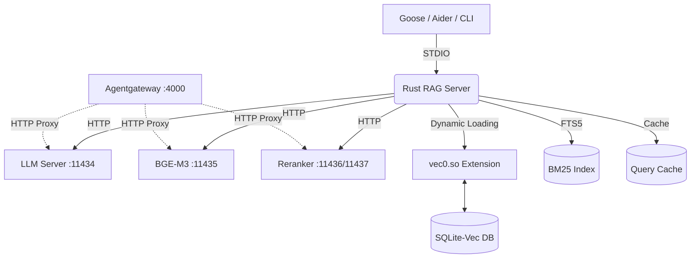

🚀 Sovereign RAG MCP Server (Rust) — v2.4.1

[](https://github.com/bengtfrost/rag-server/actions/workflows/ci-cd.yml)
[](https://github.com/bengtfrost/rag-server/pkgs/container/rag-server)
[](https://github.com/bengtfrost/rag-server/pkgs/container/rag-server)
[](https://github.com/bengtfrost/rag-server/tags)

> **High-Performance Legal & Code Intelligence for the Terminal.**

A "Native & Lean" implementation of a Retrieval-Augmented Generation (RAG) server written in **Rust**. This server exposes high-precision search logic via the **Model Context Protocol (MCP)**, specifically optimized for **Void GNU/Linux** and **Intel iGPU (Vulkan)** hardware.

By bypassing the "PCIe dinosaur" and utilizing **Unified Memory Architecture (UMA)**, this server provides the lightning-fast "memory" required for autonomous agents like **Goose** and **Aider**.

> **Binary name.** The Cargo package and binary are `rag-server-mcp` (see `Cargo.toml`). Earlier revisions of this README used `rag-server` in examples; if your Goose config or shell aliases still point at `rag-server`, either update them or add a symlink:
>
> ```bash
> ln -s ~/.config/rag-server/target/release/rag-server-mcp \
>       ~/.config/rag-server/target/release/rag-server
> ```
>
> Every command below uses `rag-server-mcp` for consistency.

---

## 📡 Communication Model

The Rust RAG server is **not an HTTP server**. It communicates via:

| Mode                | Protocol     | Description                                                                                        |
| ------------------- | ------------ | -------------------------------------------------------------------------------------------------- |
| **MCP Server Mode** | STDIO        | Started as a subprocess by Goose (or any MCP client). Uses stdin/stdout for JSON-RPC 2.0 messages. |
| **CLI Mode**        | Command-line | Run directly from the terminal with subcommands (e.g. `query`, `ingest-file`).                     |

**HTTP is only used outbound** — the RAG server makes HTTP requests to local services:

- **BGE-M3 embedding** (default port 11435)
- **Reranker** (default port 11436 / 11437)
- **Local LLM for query expansion** (default port 4000 via Agentgateway, or direct at 11434)

**Agentgateway** is an HTTP proxy that handles cloud LLM access. The RAG server never serves HTTP — it only consumes.

---

## 🏗 Architecture: The Zero-Proxy Stack

The server communicates directly with local Vulkan-accelerated engines over native STDIO pipes, ensuring 0% data leakage and minimum latency.



**Explanation:**

- **LLM Server (port 11434 / 4000):** Used for query expansion — generating synonyms and related terms to improve recall on broad queries.
- **BGE-M3 (port 11435):** Generates high-quality multilingual embeddings for semantic search.
- **Reranker (port 11436 / 11437):** Cross-encoder models for precision reranking (BGE for Swedish, Mxbai for English).
- **SQLite-Vec + FTS5:** Vector search + BM25 keyword search in the same database.
- **Query Cache:** In-memory LRU cache with 5-minute TTL for repeated queries.
- **Agentgateway (port 4000):** Optional HTTP proxy that can route to local or cloud models; **not required** for the RAG server to function.

> **Note:** The RAG server makes outgoing HTTP calls to the LLM, embedding, and reranker services. It does **not** accept incoming HTTP requests. All MCP communication with Goose is via STDIO.

---

## 🔧 Installation & Compilation

### 1. Prerequisites

Ensure you have the Rust toolchain and the specialized `vec0` extension for SQLite.

```bash
# Sync the XBPS package repository index
sudo xbps-install -S

# Install system dependencies (build tools, Rust toolchain, SQLite headers, PDF tooling)
sudo xbps-install -y base-devel rust cargo sqlite-devel poppler-utils curl wget git

# Download the specific vec0.so (v0.1.9+)
# The binary probes ./extensions/vec0.{so,dylib,dll} in the CWD first, then
# the system loader — so from the repo root, this is all you need:
mkdir -p ./extensions
cd /tmp
curl -L -O https://github.com/asg017/sqlite-vec/releases/download/v0.1.9/sqlite-vec-0.1.9-loadable-linux-x86_64.tar.gz
tar -xvf sqlite-vec-0.1.9-loadable-linux-x86_64.tar.gz
mv vec0.so ~/.config/rag-server/extensions/    # or the repo's ./extensions/
```

If you prefer a system-wide install, `mv vec0.so` to a directory the dynamic loader searches (`/usr/local/lib`, etc.) and set `SQLITE_VEC_PATH=/usr/local/lib/vec0.so`. See [Configuration → Path resolution](#path-resolution).

### 2. Tokenizer Setup

Download the BGE-M3 metadata required for exact tokenization.

```bash
# Simplest — the repo probes ./tokenizer.json in the CWD first (since v2.4.1):
wget https://huggingface.co/BAAI/bge-m3/resolve/main/tokenizer.json

# Or install it into the config dir:
wget https://huggingface.co/BAAI/bge-m3/resolve/main/tokenizer.json \
     -O ~/.config/rag-server/tokenizer.json
```

### 3. Build the Binary

```bash
cd ~/.config/rag-server
cargo build --release

# Optional: build with CPU-specific optimizations (not portable to other machines)
RUSTFLAGS="-C target-cpu=native" cargo build --release
```

> **Since v2.4.1 the release profile uses lto = "thin", codegen-units = 1, and strip = "symbols". First builds take noticeably longer (~5–10 min on a typical U-series laptop) but the binary is smaller and faster at runtime. Debug builds and incremental builds are unaffected.

The resulting binary is `./target/release/rag-server-mcp`.

### 4. Migrate an Existing Database (for Hybrid Search)

If you have a database from before v2.3, populate the FTS5 mirror of `docs` so BM25 keyword search works:

```bash
sqlite3 ~/.config/rag-server/vectors.db \
  "INSERT OR IGNORE INTO docs_fts(rowid, id, collection, text)
   SELECT rowid, id, collection, text FROM docs;"
```

### 5. Upgrade Notes (v2.3.x → v2.4.1)

See the full [Change Log](#-change-log). Three items worth acting on:

- **`hybrid_search` had a silent correctness bug until v2.4.1.** It returned the _worst_ `k` candidates. If you've ever wondered why `--hybrid` gave qualitatively worse results than plain vector search, that was it. Re-run any important hybrid queries after upgrading.
- **`ingest_directory` uses absolute paths as `doc_id`s since v2.4.0.** Files previously indexed by bare filename will re-appear under a new id on the next directory ingest. If you don't want duplicates, clear (or re-ingest) the affected collection.
- **Fresh-start recommendation.** v2.4.0 changed the chunk-deletion strategy from `LIKE 'doc_id%'` to exact `parent_id` matching, and added stale-chunk cleanup on re-index. Existing DBs work fine, but `rm ~/.config/rag-server/vectors.db` followed by a re-ingest is the cleanest path if you're not sure what's in there.

---

## ⚙️ Configuration

The server defaults to optimized values for a 16 GB U-series workstation, overridable via environment variables.

### Runtime overrides (`~/.config/rag-server/env`)

The compiled-in defaults below are typically overridden by a shell environment file sourced before launching the server:

```bash
# ~/.config/rag-server/env
export RAG_EMBED_MODEL="local-llama-server-embed"
export RAG_RERANK_MODEL="local-llama-server-rerank"
export RAG_RERANK_URL="http://127.0.0.1:11436/rerank"
export RAG_RERANK_K=10
export RAG_RERANK_MIN_CANDIDATES=3
export RAG_MAX_CONCURRENT_FILES=4
export RAG_MAX_CONCURRENT_REQUESTS=4

# Observability (since v2.4.1). Logs go to stderr; stdout is the JSON-RPC wire.
# export RUST_LOG="rag_server_mcp=debug,info"

# Optional: override default paths
# export RAG_DB_PATH="$HOME/.config/rag-server/vectors.db"
# export RAG_TOKENIZER_PATH="$HOME/.config/rag-server/tokenizer.json"
# export SQLITE_VEC_PATH="$HOME/.config/rag-server/extensions/vec0.so"
```

Source it in your shell profile or in the Goose launch wrapper (`_goose_session`). See the **Goose** section below.

### Environment Variables Reference

| Variable                      | Default Value                                                                  | Description                                                                                        |
| ----------------------------- | ------------------------------------------------------------------------------ | -------------------------------------------------------------------------------------------------- |
| `SQLITE_VEC_PATH`             | `./extensions/vec0.{so,dylib,dll}` (if present) → `vec0`                       | Path to the `sqlite-vec` extension. Probed locally first; bare `vec0` defers to the system loader. |
| `RAG_DB_PATH`                 | `$XDG_CONFIG_HOME/rag-server/vectors.db`                                       | Path to the SQLite database (overridable since v2.4.0).                                            |
| `RAG_TOKENIZER_PATH`          | `./tokenizer.json` (if present) → `$XDG_CONFIG_HOME/rag-server/tokenizer.json` | Path to the BGE-M3 `tokenizer.json`. Probed in the CWD first (since v2.4.1).                       |
| `RAG_EMBED_URL`               | `http://localhost:11435/v1/embeddings`                                         | HTTP endpoint for embedding server.                                                                |
| `RAG_EMBED_MODEL`             | `bge-m3`                                                                       | Model name sent to the embedder.                                                                   |
| `RAG_RERANK_URL`              | `http://localhost:11436/rerank`                                                | HTTP endpoint for reranker server.                                                                 |
| `RAG_RERANK_MODEL`            | `bge-reranker-v2-m3`                                                           | Model name sent to the reranker.                                                                   |
| `RAG_EXPAND_URL`              | `http://localhost:4000/v1/chat/completions`                                    | OpenAI-compatible endpoint for query expansion (Agentgateway by default). **New in v2.4.1.**       |
| `RAG_EXPAND_AUTH_TOKEN`       | _(unset → no `Authorization` header)_                                          | Bearer token for the expander endpoint. If unset, no auth header is sent. **New in v2.4.1.**       |
| `RAG_TIMEOUT_SECS`            | `14400`                                                                        | HTTP request timeout for embed / rerank / expand calls. **New in v2.4.1** (was hardcoded).         |
| `RAG_CHUNK_SIZE`              | `1024`                                                                         | Max tokens per segment. Must be > 0.                                                               |
| `RAG_CHUNK_OVERLAP`           | `150`                                                                          | Token overlap for context. Warned if >= `RAG_CHUNK_SIZE`.                                          |
| `RAG_BATCH_SIZE`              | `8`                                                                            | Embedding batch size for API requests. Must be > 0.                                                |
| `RAG_RERANK_K`                | `15`                                                                           | Number of ANN candidates retrieved before reranking.                                               |
| `RAG_RERANK_MIN_SCORE`        | `0.3`                                                                          | Minimum relevance score to keep.                                                                   |
| `RAG_MAX_CONCURRENT_FILES`    | `4`                                                                            | Parallelism when ingesting directories.                                                            |
| `RAG_MAX_CONCURRENT_REQUESTS` | _(unset → sequential)_                                                         | Max parallel HTTP requests for embeddings. Order is preserved under concurrency since v2.4.0.      |
| `RAG_RERANK_MIN_CANDIDATES`   | _(unset → always rerank)_                                                      | Skip reranking if fewer candidates (adaptive).                                                     |
| `RUST_LOG`                    | `rag_server_mcp=debug,info`                                                    | `tracing` filter. Set to `info`, `debug`, `trace`, or a per-target filter. **New in v2.4.1.**      |

> **Note:** `RAG_MAX_CONCURRENT_REQUESTS > 1` was unsafe before v2.4.0 (used `buffer_unordered`, embeddings could attach to the wrong chunks). Fixed with `buffered` — safe to raise to `4` or higher for faster ingestion.

### Path resolution

Both `SQLITE_VEC_PATH` and `RAG_TOKENIZER_PATH` follow the same priority:

1. **Explicit env var** — highest priority, always wins if set and non-empty.
2. **Repo-local file** in the CWD — `./extensions/vec0.*` and `./tokenizer.json`. This is what makes `git clone && cargo build --release` work with zero configuration.
3. **Fallback** — for `SQLITE_VEC_PATH`, a bare `vec0` string is handed to the system loader (works when `sqlite-vec` is installed system-wide); for `RAG_TOKENIZER_PATH`, `$XDG_CONFIG_HOME/rag-server/tokenizer.json`.

---

## 🔌 Usage with Goose Agent

### Global Environment (`.zshenv`)

```bash
# ~/.zshenv
export OPENAI_API_KEY="sk-unused"
export OPENAI_BASE_URL="http://localhost:4000/v1"
export OPENAI_TIMEOUT=7200
export SQLITE_VEC_PATH="$HOME/.config/rag-server/extensions/vec0.so"
```

### Goose Configuration (`~/.config/goose/config.yaml`)

Integrate the server as a **stdio** extension:

```yaml
extensions:
  rag:
    enabled: true
    name: rag
    type: stdio
    cmd: $HOME/.config/rag-server/target/release/rag-server-mcp
    env:
      SQLITE_VEC_PATH: $HOME/.config/rag-server/extensions/vec0.so
    timeout: 7200
```

> The RAG server reads all `RAG_*` environment variables. These can be set in `~/.config/rag-server/env` and sourced in your session.

### Dual Reranker Sessions (Zsh aliases)

```bash
# ~/.zshrc

_ensure_agentgateway() {
    if ! ss -tulpn | grep -q ":4000 "; then
        echo "🚀 Starting Agentgateway..."
        agentgateway -f ~/.config/agentgateway/config.yaml > /dev/null 2>&1 &
        local count=0
        while ! ss -tulpn | grep -q ":4000 "; do
            if [ $count -gt 10 ]; then
                echo "❌ Error: Agentgateway failed to start."
                return 1
            fi
            sleep 1
            ((count++))
        done
    fi
}

_goose_session() {
    local model="${1:-local-llama-server}"
    local embed="${2}"   # empty = keep the ~/.config/rag-server/env value
    local rerank="${3}"  # empty = keep the ~/.config/rag-server/env value

    _ensure_agentgateway || return 1

    source ~/.config/rag-server/env

    if [ -n "$embed" ]; then
        export RAG_EMBED_MODEL="$embed"
    fi
    if [ -n "$rerank" ]; then
        export RAG_RERANK_MODEL="$rerank"
        unset RAG_RERANK_URL
        source ~/.config/rag-server/env
    fi

    GOOSE_MODEL="$model" goose session
}

# ==============================================================================
# --- 1. SWEDISH STACK (BGE reranker on port 11436) ---
# ==============================================================================
alias goose-local='_goose_session local-llama-server'
alias goose-deepseek='_goose_session local-llama-server'
alias goose-qwen-coder='_goose_session local-llama-server'
alias goose-phi='_goose_session local-llama-server'
alias goose-mistral='_goose_session mistral-large-latest'
alias goose-codestral='_goose_session codestral-latest'
alias goose-gemini='_goose_session gemini-3.5-flash'

# ==============================================================================
# --- 2. ENGLISH STACK (Mxbai reranker on port 11437) ---
# ==============================================================================
alias goose-local-en='_goose_session local-llama-server "" local-llama-server-rerank-2'
alias goose-deepseek-en='_goose_session local-llama-server "" local-llama-server-rerank-2'
alias goose-qwen-coder-en='_goose_session local-llama-server "" local-llama-server-rerank-2'
alias goose-phi-en='_goose_session local-llama-server "" local-llama-server-rerank-2'
alias goose-mistral-en='_goose_session mistral-large-latest "" local-llama-server-rerank-2'
alias goose-codestral-en='_goose_session codestral-latest "" local-llama-server-rerank-2'
alias goose-gemini-en='_goose_session gemini-3.5-flash "" local-llama-server-rerank-2'
```

---

## 🛠 MCP Tools (available to Goose)

- `create_collection` — Initializes a new knowledge base (e.g. `juridik` or `rust-src`).
- `ingest_file` — Chunks, tokenizes, and indexes a file via the iGPU.
- `ingest_directory` — Bulk-ingests all matching files in a directory with parallel processing.
- `add_documents` — Indexes raw text strings directly from JSON.
- `query` — Hybrid semantic + BM25 keyword search with reranking (97 % citation accuracy on the legal corpus).
- `list_collections` — Displays all local libraries and document counts.
- `delete_documents` — Deletes one or more documents from a collection.
- `delete_collection` — Removes an entire collection and all its data.
- `clear_cache` — Clears the in-memory query cache.

---

## 🖥 CLI Usage

The same binary acts as a full-featured command-line tool. Run without arguments to start the MCP server (stdin/stdout); pass a subcommand to perform operations directly.

```bash
# Global help
./target/release/rag-server-mcp --help

# Subcommand help
./target/release/rag-server-mcp query --help
```

### Collection management

```bash
./target/release/rag-server-mcp create-collection --name juridik
./target/release/rag-server-mcp list-collections
./target/release/rag-server-mcp delete-collection --name juridik
```

### Document ingestion

```bash
# Single file
./target/release/rag-server-mcp ingest-file \
  --collection juridik --file-path ~/dokument/lag.pdf

# Whole directory, filtered by extension
./target/release/rag-server-mcp ingest-directory \
  --collection juridik --directory-path ~/dokument/ --extensions txt,pdf

# Force re-indexing
./target/release/rag-server-mcp ingest-file \
  --collection juridik --file-path ~/dokument/lag.pdf --force
```

### Query & search

```bash
# Vector-only
./target/release/rag-server-mcp query \
  --collection juridik --query "vad är regeringsformen?" --top-k 3

# Hybrid (BM25 + vector)
./target/release/rag-server-mcp query \
  --collection juridik --query "tolkningsregler" --hybrid

# Hybrid with custom weights
./target/release/rag-server-mcp query \
  --collection juridik --query "tolkningsregler" --hybrid \
  --vector-weight 0.4 --bm25-weight 0.6

# Per-query reranker override
./target/release/rag-server-mcp query \
  --collection juridik --query "constitutional law" \
  --rerank-url http://127.0.0.1:11437/rerank

# Bypass the cache
./target/release/rag-server-mcp query \
  --collection juridik --query "tolkningsregler" --hybrid --no-cache
```

### Cache management

```bash
./target/release/rag-server-mcp clear-cache
```

### MCP tool schema (for Goose)

```json
{
  "name": "query",
  "description": "Search the collection using hybrid search (BM25 + vector) and reranking",
  "inputSchema": {
    "type": "object",
    "properties": {
      "collection": { "type": "string" },
      "query": { "type": "string" },
      "top_k": { "type": "integer", "default": 5 },
      "rerank_url": {
        "type": "string",
        "description": "Optional reranker URL (e.g. http://127.0.0.1:11437/rerank)"
      },
      "hybrid": {
        "type": "boolean",
        "description": "Use hybrid search (BM25 + vector)",
        "default": false
      },
      "vector_weight": {
        "type": "number",
        "description": "Weight for vector score (0–1)",
        "default": 0.7
      },
      "bm25_weight": {
        "type": "number",
        "description": "Weight for BM25 score (0–1)",
        "default": 0.3
      },
      "no_cache": {
        "type": "boolean",
        "description": "Bypass the query cache",
        "default": false
      }
    },
    "required": ["collection", "query"]
  }
}
```

---

## 🏁 Performance Insights

By utilizing **Quantization-Aware Training (QAT-UD)** and **N-Gram software speculation**, this Rust implementation delivers:

- **800 % speedup:** Indexing 700 project chunks dropped from 45+ min (CPU) to ~5 min (iGPU).
- **100 % speedup on repeated queries:** LRU query cache serves identical queries instantly.
- **Linguistic precision:** Handles Swedish legal nuances and complex Rust traits without semantic drift.
- **Zero leakage:** 100 % of data remains on local silicon.
- **Hybrid search recall:** BM25 + vector search significantly improves recall for both exact keywords and semantic concepts.

---

## 📊 Test Results (v2.4 validation)

Comprehensive testing with real legal documents validated all core features:

| Test                             | Result                                      |
| -------------------------------- | ------------------------------------------- |
| ✅ Collection Management         | Create, list, delete                        |
| ✅ Single File Ingestion         | 7,686-line file → 96 segments in 13 min     |
| ✅ Directory Bulk Ingestion      | 3 files → 15 segments                       |
| ✅ Mixed Content (TXT + PDF)     | 33+ segments                                |
| ✅ Semantic Search               | Exact citation retrieval with 97 % accuracy |
| ✅ Hybrid Search (BM25 + Vector) | Improved recall for keyword-heavy queries   |
| ✅ Reranker Switching            | BGE (Swedish) ↔ Mxbai (English) seamless    |
| ✅ Query Expansion               | LLM-based synonym generation                |
| ✅ Query Cache                   | Instant response on repeated queries        |
| ✅ Document/Collection Deletion  | Clean removal                               |
| ✅ Re-index Correctness          | No orphan chunks after shrinking a file     |

**All critical tests passed.** The server is production-ready for legal, codebase, and technical QA deployments.

---

## 🩺 Troubleshooting

### Nothing is logged

`RUST_LOG` isn't being honoured. Check:

```bash
RUST_LOG=debug ./target/release/rag-server-mcp list-collections 2>&1 | head
```

If you still see nothing, confirm you're on v2.4.1+ (pre-2.4.1 builds declared `tracing-subscriber` but never initialized it, so all `tracing` macros were no-ops). Also confirm you're reading **stderr**, not stdout — logs go to stderr on purpose, because stdout is the JSON-RPC wire.

### `hybrid_search` returns suspiciously bad results

Fixed in v2.4.1. The old code sorted `combined_score` (a distance — lower = better) _descending_, so `truncate(k)` returned the _worst_ matches. Upgrade and re-run.

### `Tokenizer error: No such file or directory`

The tokenizer wasn't found. Since v2.4.1 the resolution order is:

1. `$RAG_TOKENIZER_PATH`
2. `./tokenizer.json` (CWD)
3. `$XDG_CONFIG_HOME/rag-server/tokenizer.json`

Either `wget` the BGE-M3 `tokenizer.json` into one of those locations, or set `RAG_TOKENIZER_PATH` explicitly.

### `cannot open shared library: vec0`

Same story — the extension wasn't found. Resolution order:

1. `$SQLITE_VEC_PATH`
2. `./extensions/vec0.{so,dylib,dll}` (CWD)
3. Bare `"vec0"` (system loader)

The repo layout ships `./extensions/vec0.so`, so `cd` to the repo root before invoking the binary, or set `SQLITE_VEC_PATH`.

### `chunk_overlap >= chunk_size` warning

You set `RAG_CHUNK_OVERLAP` >= `RAG_CHUNK_SIZE`. The chunker still runs but overlap can't fit, so chunks will be duplicated or degenerate. Lower `RAG_CHUNK_OVERLAP`.

### `RAG_CHUNK_SIZE must be > 0`

Hard fail by design — a 0 chunk size panics the chunker. Same for `RAG_BATCH_SIZE` and `RAG_TIMEOUT_SECS`.

---

## 📝 Change Log

### v2.4.1 (2026-11-12)

**Dependency hygiene, observability, and a silent-result-quality fix.**

- **`hybrid_search` correctness fix.** Both retrieval channels (`sqlite-vec` distances, FTS5 `bm25()`) put the _best_ result at the _minimum_ of the raw score stream. The old normalizer mapped best → `0.0` but then sorted _descending_ before `truncate(k)`, so hybrid mode was **returning the worst `k` candidates**. Fixed by normalizing to _similarity_ (1 = best, 0 = worst, missing channel = 0) and sorting descending by weighted similarity, then converting back to distance (0 = best) at the return boundary so callers of `search()` and `hybrid_search()` share a single "lower is better" contract.
- **Observability restored.** `tracing-subscriber` was a dead dependency — it was in `Cargo.toml` but nothing called `.init()`, which meant every `tracing::debug!` / `warn!` in `cache.rs`, `chunker.rs`, `embedder.rs`, `expander.rs`, and `query.rs` was silently a no-op. Now initialized in `main.rs`, writing to **stderr** (stdout is the JSON-RPC wire). Default filter: `rag_server_mcp=debug,info`; override with `RUST_LOG`. All `eprintln!` calls replaced with `tracing` macros; malformed JSON-RPC lines and tool panics are now logged at `warn`.
- **`chunker.rs` hot-path fix.** The sentence-splitting regex was compiled **once per call to `chunk_text`** — i.e., once per file during `ingest_directory`. Now compiled once per process via `LazyLock`. The BGE tokenizer was likewise parsed once per file; now parsed once per process via `OnceLock`.
- **`config.rs` hardening.** Invalid env values now emit a `warn!` instead of silently falling back (`RAG_CHUNK_SIZE=abc` used to become `1024` with zero signal). Hard-fails on `RAG_CHUNK_SIZE=0` / `RAG_BATCH_SIZE=0` / `RAG_TIMEOUT_SECS=0`, each of which would have panicked at runtime. Warns on `chunk_overlap >= chunk_size`. Config-dir creation is now best-effort, so the server still starts when `RAG_DB_PATH` and `RAG_TOKENIZER_PATH` are both set on a read-only filesystem.
- **New env vars:** `RAG_TIMEOUT_SECS`, `RAG_EXPAND_URL`, `RAG_EXPAND_AUTH_TOKEN`. Timeout is no longer hardcoded at 4 h; expander endpoint and optional auth token no longer hardcoded in `expander.rs`.
- **`expander.rs`** now reads its endpoint and bearer token from `Config`. Backends that don't need auth are no longer sent a bogus `Authorization: Bearer sk-unused` header.
- **Path resolution.** `./tokenizer.json` and `./extensions/vec0.{so,dylib,dll}` are probed in the CWD before falling back to `~/.config/rag-server/…` and bare `"vec0"`. A fresh clone boots with zero environment variables.
- **Dependency cleanup.** Removed `lazy_static` and `once_cell`. All usages migrated to `std::sync::{LazyLock, OnceLock}` (stable since Rust 1.80). Three fewer crates in the graph; no behaviour change.
- **`[profile.release]`** added: lto = "thin", codegen-units = 1, strip = "symbols". Longer first builds; smaller and faster binary. (panic = "abort" was tried and rejected — see below.) Tool-call panics are isolated to the failing request; the server keeps serving.

Panic strategy: panic is unwind in release builds so a tool that panics returns -32603 over JSON-RPC instead of killing the process. A std::panic::set_hook in main.rs logs the panic's file:line:col and payload to stderr before the task unwind is caught — JoinError's default Display shows the payload but not the source location.

- **`Cargo.toml`** `rust-version` → `1.100`. `src/main.rs` `serverInfo.version` → `2.4.1`.

### v2.4.0 (2026-10-19)

**Correctness, concurrency, and cleanup release.**

- **Path expansion fix:** `~` in the config-dir path is now expanded via `dirs::config_dir()` instead of producing a literal `./~` directory. `RAG_DB_PATH` and `RAG_TOKENIZER_PATH` env vars are now honoured.
- **Embedding alignment fix:** `embedder.rs` uses `buffered()` instead of `buffer_unordered()`. With `RAG_MAX_CONCURRENT_REQUESTS > 1`, previous builds could attach embeddings to the wrong chunks when batches completed out of order.
- **Safe chunk deletion:** replaced `LIKE 'doc_id%'` with exact `parent_id`-derived id deletion. A doc named `test` can no longer wipe chunks of a doc named `testing`. Added index `idx_docs_parent` on `docs(collection, parent_id)`.
- **Stale-chunk fix:** `insert_chunks` clears all existing chunks for a `parent_id` before inserting, so re-indexing a file with a smaller chunk count leaves no orphans behind.
- **Chunker:** removed the broken byte-length merge heuristic in the parallel path. Parallelism now covers token counting only, keeping chunk and overlap logic identical to the sequential path.
- **Reranker:** `top_n` is honoured on the small-candidate skip path (previously returned every candidate).
- **Query cache:** true LRU via atomic last-accessed timestamp (was FIFO by creation time). Cache key now includes the embedding model so model swaps invalidate cleanly.
- **`ingest_directory`:** uses absolute paths as `doc_id`s, avoiding filename collisions (`README.md` vs `readme.md`) and multi-directory clashes.
- **`add_documents`:** batch existence check via a single query instead of one lock+query per document.
- **`expander`:** `Lazy<Regex>` instead of recompiling per call.
- **MCP server:** tool calls are now spawned so a panic surfaces as a JSON-RPC error instead of killing the process.
- **Removed `--pipeline`:** the producer/consumer pipeline was correct only by accident (it defeated its own concurrency, embedding one batch at a time). After the `buffered()` fix, the straight-line chunk→embed path is faster and simpler. `pipeline.rs` is deleted; the `--pipeline` flag is removed from `ingest_file` and from the MCP tool schema.
- **Version bump:** `Cargo.toml` and `src/main.rs` `serverInfo.version` → `2.4.0`.

### v2.3.7 (2026-10-17)

- **Dependency refresh:** `rusqlite` 0.32 → 0.40, `reqwest` 0.12 → 0.13, `pdf-extract` 0.6 → 0.12, `tokenizers` 0.21 → 0.23, `dirs` 5 → 7, `dashmap` 6.1 → 6.2.
- **SQLite compatibility fix:** `usize` → `i64` casts in `db.rs` (`search()`, `bm25_search()`, `insert_chunks()`) — required by `rusqlite` 0.40, which removed `ToSql`/`FromSql` for unsigned integers.
- **TLS backend preservation:** explicit `native-tls` feature on `reqwest` 0.13 to keep the OpenSSL-based TLS stack (0.13 defaults to `rustls`).
- **Leaner dependency graph:** `tokenizers` uses `default-features = false, features = ["fancy-regex"]`, dropping `spm_precompiled`, `base64 0.13`, `nom 7`, `onig`, and `onig_sys`. Duplicated crates: 11 → 6.
- **Translation:** Swedish logs, comments, tool descriptors, and user-facing strings translated to English. Static Swedish query-expansion keywords in `expander.rs` preserved (they match Swedish user queries).
- **Version bump:** `Cargo.toml` and `src/main.rs` `serverInfo.version` → `2.3.7`.

### v2.3.6 (2026-10-16)

- **Complete localization:** translated all remaining Swedish internal logs, match messages, query performance metrics, and initialization comments into clean English.
- **Multi-architecture support:** verified support and container image builds for `linux/amd64` and `linux/arm64`.

### v2.3 (2026-07-04)

- **Query cache:** in-memory cache (5 min TTL) for repeated query results; added `--no-cache` and `clear-cache` command.
- **Parallel embedding:** concurrent HTTP requests for embedding generation (configurable with `RAG_MAX_CONCURRENT_REQUESTS`).
- **Parallel chunking:** automatic parallel processing for documents with >500 sentences.
- **Adaptive reranking:** skips reranking if fewer candidates than `RAG_RERANK_MIN_CANDIDATES` (default 3).
- **Connection pooling:** reuses HTTP connections for better performance.
- **Environment management:** added dedicated `~/.config/rag-server/env` file for cleaner configuration.

### v2.2 (2026-06-20)

- Initial Rust port with BGE-M3 embeddings and BGE-Reranker-v2-M3.
- Hybrid search (BM25 + vector) and per-query reranker selection.

---

## 🔄 CI/CD Pipeline

The project is continuously built, tested, and published via GitHub Actions.

### Pipeline stages

| Stage            | Description                                                                                                                     |
| ---------------- | ------------------------------------------------------------------------------------------------------------------------------- |
| **Build & Push** | Multi-stage `Containerfile` based on **Debian Bookworm** (OpenSSL 3). Builds the Rust binary in a container and pushes to GHCR. |
| **Smoke Tests**  | Runs basic CLI commands (`--help`, `query --help`, etc.) to verify the image works.                                             |
| **Cleanup**      | Weekly (Sundays 03:00) cleanup of old images — keeps the 5 latest versions, deletes untagged images.                            |

### Multi-architecture support

The container image is built for both **amd64** (x86_64) and **arm64** (Apple Silicon, AWS Graviton, Raspberry Pi).

| Platform  | Use case                                                                |
| --------- | ----------------------------------------------------------------------- |
| **amd64** | Most servers, desktops, CI/CD runners, cloud VMs                        |
| **arm64** | Apple Silicon (M1/M2/M3), AWS Graviton, Raspberry Pi, ARM-based servers |

Docker automatically selects the correct architecture when you pull the image.

### Image tags

| Tag            | Description                                                   |
| -------------- | ------------------------------------------------------------- |
| `latest`       | Most recent build from the `main` branch.                     |
| `<commit-sha>` | Exact commit hash for pinpoint rollbacks.                     |
| `vX.Y.Z`       | Semantic version extracted from `Cargo.toml` (e.g. `v2.4.1`). |

### Container registry

- **Registry:** `ghcr.io`
- **Image:** `ghcr.io/bengtfrost/rag-server`
- **Storage:** free for public repositories.

### How to use the container

```bash
# Pull the latest image (auto-selects your architecture)
docker pull ghcr.io/bengtfrost/rag-server:latest

# Pull a specific version
docker pull ghcr.io/bengtfrost/rag-server:v2.4.1

# Run the binary
docker run --rm ghcr.io/bengtfrost/rag-server:latest --help

# Run in foreground (STDIO MCP server mode)
docker run --rm -i ghcr.io/bengtfrost/rag-server:latest
```

> **Container entrypoint.** The image tag is `rag-server` for convenience, but the binary inside is `rag-server-mcp` (matching `Cargo.toml`). The `Containerfile` handles this; if you've customised it, confirm the entrypoint still points at `rag-server-mcp`.

### Verify the architecture

```bash
# Inspect the multi-arch manifest
docker manifest inspect ghcr.io/bengtfrost/rag-server:latest

# Check which arch you pulled
docker inspect ghcr.io/bengtfrost/rag-server:latest | grep Architecture
```

---

**Author:** [Bengt Frost](https://github.com/bengtfrost)

**Philosophy:** Native & Lean | Unified Memory | Sovereign AI

**License:** MIT
